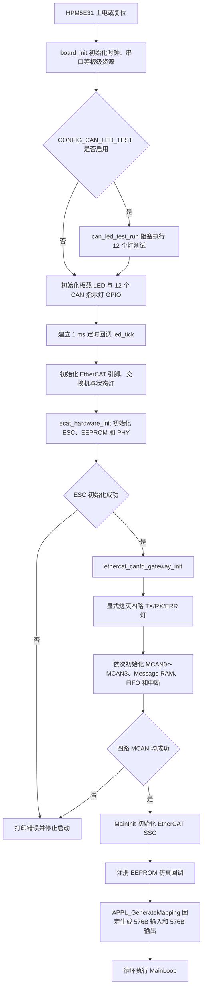
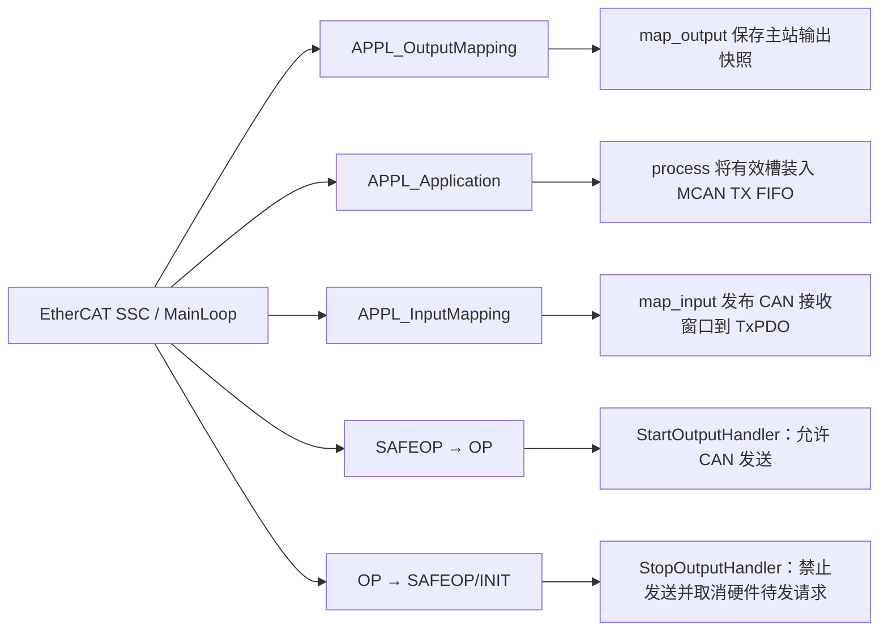
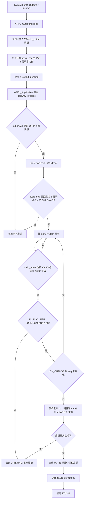
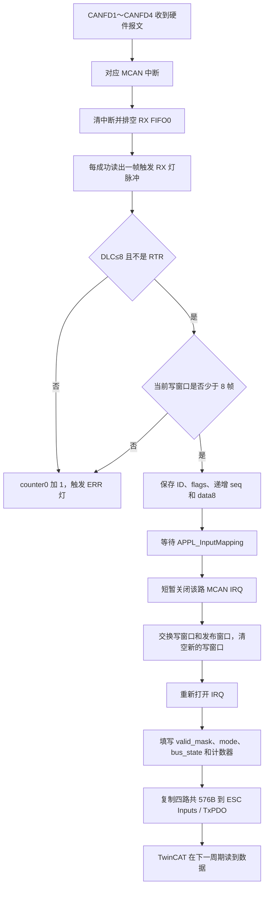
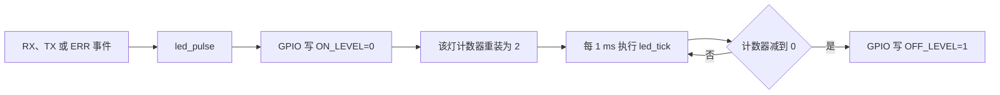

# EtherCAT 转 CAN FD 网关固件流程与指示灯逻辑

> 历史透明网关版本说明：过程映像、回调和调度描述不直接代表当前 ENCOS 电机业务。当前实现入口见[目录清单](current/PROJECT_LAYOUT.md)，协议文件见[生成清单](current/GENERATED_FILES.md)。

本文说明 HPM5E31 自研板网关固件的启动流程、EtherCAT 与四路 CAN FD 之间的数据透传路径、过程映像格式，以及 TX/RX/ERR 指示灯的实际触发逻辑。

本文对应当前工程代码。TwinCAT 3 的 XML 导入、EEPROM 烧写、PDO 绑定和 PLC 测试程序请参见 [TwinCAT3验证EtherCAT转CANFD透传网关.md](TwinCAT3验证EtherCAT转CANFD透传网关.md)。

## 1. 固件功能概览

网关在 EtherCAT 主站和四路独立 MCAN 控制器之间搬运报文：

```text
TwinCAT 3 主站
       │ EtherCAT 周期过程数据
       ▼
HPM5E31 EtherCAT 从站控制器（ESC）
       │ 固定 576 字节 RxPDO / 576 字节 TxPDO
       ▼
EtherCAT/CAN FD 网关应用
       ├── MCAN0 ── CANFD1
       ├── MCAN1 ── CANFD2
       ├── MCAN2 ── CANFD3
       └── MCAN3 ── CANFD4
```

关键特性：

- 四路 CAN FD 相互独立，可并行收发。
- CAN 仲裁段速率为 `1 Mbit/s`，数据段速率为 `5 Mbit/s`，启用 BRS 和 TDC 能力。
- 每个 EtherCAT 方向固定为 576 字节，即四路总线各 144 字节。
- 每路每个 EtherCAT 接收窗口最多发布 8 帧，每帧槽可携带 0～8 字节有效数据。
- 固件只校验 CAN 帧头，`data[8]` 原样复制，不解释电机协议，也不改变字节顺序。
- 只有 EtherCAT 进入 OP 状态后才允许主站数据下发到 CAN。
- 所有硬件发送和接收均采用中断或非阻塞 FIFO，不在实时路径中等待 CAN 总线。

> 为保持现有 16 字节槽和 TwinCAT PDO 兼容，当前支持 DLC 0～8。DLC 9～15 对应的 12～64 字节 CAN FD 长帧以及 RTR 远程帧不会被透传。

## 2. 主要源文件和职责

| 文件 | 主要职责 |
|---|---|
| `ecat.c` | 程序入口，初始化板级资源、ESC、四路 MCAN、SSC，并循环执行 `MainLoop()` |
| `application/digital_io.c` | SSC 应用回调，将 EtherCAT 状态机和 PDO 映射接入网关 |
| `application/ethercat_canfd_gateway.h` | 过程映像结构、标志位、总线数和槽位数定义 |
| `application/ethercat_canfd_gateway.c` | 四路 CAN FD 初始化、收发透传、双缓冲、看门狗和 LED 控制 |
| `application/can_led_test.c` | 可选的开机阻塞式 LED 硬件测试；正常网关运行时默认不启用 |
| `hpm_sdk_localized_for_hpm5e00evk/boards/hpm5e00evk/board.h` | 四路 TX/RX/ERR LED 的 GPIO 和有效电平定义 |

## 3. 程序启动流程



`ethercat_canfd_gateway_init()` 在打开 MCAN 中断之前会再次把 12 个 CAN 灯写成 OFF。这样可以消除 PinMux 把引脚切换成 GPIO 时短暂拉低所造成的“上电无数据但灯常亮”。

## 4. EtherCAT 运行时调用关系

SSC 根据 EtherCAT 状态和同步事件调用 `digital_io.c` 中的应用回调：



主站视角的方向必须分清：

- **RxPDO / Outputs**：主站写给从站，最终由 CANFD1～CANFD4 向外发送。
- **TxPDO / Inputs**：从站写给主站，内容来自 CANFD1～CANFD4 的接收报文和状态计数。

## 5. 固定过程映像

### 5.1 总体大小

| 层级 | 数量 | 单项大小 | 合计 |
|---|---:|---:|---:|
| 单帧槽 `canfd_slot_pdo_t` | 每路 8 个 | 16 字节 | 128 字节 |
| 单路头部 | 每路 1 个 | 16 字节 | 16 字节 |
| 单路 `canfd_bus_pdo_t` | 4 路 | 144 字节 | 576 字节 |
| 单方向过程映像 | 1 个 | 576 字节 | RxPDO 576 字节或 TxPDO 576 字节 |

结构均使用 `packed`，源码通过 `_Static_assert` 检查 16、144、576 字节，防止编译器填充导致 ESI/PDO 偏移不一致。

### 5.2 单路 16 字节头部

| 字段 | 类型 | 主站下发时 | 从站上报时 |
|---|---|---|---|
| `cycle_seq` | `UINT16` | 主站周期序号，应持续变化 | 回显最近的主站周期序号 |
| `valid_mask` | `USINT` | Bit0～Bit7 分别使能 Slot0～Slot7 | 指示本窗口哪些槽包含新接收帧 |
| `mode` | `USINT` | 当前保留 | 本窗口接收帧数，范围 0～8 |
| `deadline_us` | `UINT16` | 预留的发送预算字段 | 当前为 0 |
| `bus_state` | `UINT16` | 不用于下发 | 0 正常、1 Warning、2 Error Passive、3 Bus-Off |
| `counter0` | `UDINT` | 不用于下发 | 累计接收丢弃数 |
| `counter1` | `UDINT` | 不用于下发 | 累计 Bus-Off 次数 |

`counter0` 不是 CAN 位错误总数。它只统计固件无法发布的接收帧，例如 DLC 大于 8、RTR 帧或当前 8 槽接收窗口溢出。

### 5.3 每个 16 字节帧槽

| 偏移 | 字段 | 类型 | 含义 |
|---:|---|---|---|
| 0 | `can_id` | `UDINT` | 标准帧使用低 11 bit，扩展帧使用低 29 bit |
| 4 | `flags` | `USINT` | 帧属性和发送控制标志 |
| 5 | `dlc` | `USINT` | 当前支持 0～8；仅 `data[0..dlc-1]` 有效 |
| 6 | `seq` | `UINT` | 下发用于变化检测；上报时每接收一帧递增 |
| 8 | `data[0..7]` | `ARRAY OF BYTE` | 原始 8 字节槽，未使用的尾部字节为 0 |

下发 `flags`：

| 位 | 数值 | 名称 | 含义 |
|---:|---:|---|---|
| 0 | `16#01` | `VALID` | 槽有效，且 `valid_mask` 对应位也必须为 1 |
| 1 | `16#02` | `IDE` | 使用 29 位扩展 ID；为 0 时使用 11 位标准 ID |
| 2 | `16#04` | `RTR` | 远程帧；当前固件不接受 |
| 3 | `16#08` | `FDF` | CAN FD 帧 |
| 4 | `16#10` | `BRS` | 数据段切换到 5 Mbit/s，必须与 FDF 同时使用 |
| 5 | `16#20` | `ON_CHANGE` | 仅当该槽 `seq` 改变时发送一次 |

常用组合：

- `16#19 = VALID + FDF + BRS`：每次收到新的 EtherCAT 输出快照时都可能发送。
- `16#39 = VALID + FDF + BRS + ON_CHANGE`：只有 `seq` 改变时发送，适合 PLC 用定时器控制发送周期。

上报时 bit0 表示 `NEW`，bit5 表示 CAN FD 的 ESI 状态，其他 IDE/FDF/BRS 位仍表示实际接收帧属性。

DLC 0～8 与有效字节数相同。由于帧槽和过程映像尺寸没有变化，本次升级不需要重新导入 XML、重写 EEPROM 或重新建立 PLC 数据类型。

## 6. EtherCAT 主站到 CAN FD 的透传流程



具体规则如下：

1. `APPL_OutputMapping()` 先把 ESC 过程区完整复制到 `s_output`。之后 CAN 发送不再直接读取可能被下一周期改写的 ESC 内存。
2. 四路分别检查 `cycle_seq`。同一路连续 3 个 EtherCAT 映射周期不变化后暂停该路发送，防止 PLC 停止运行时旧控制帧持续驱动电机。
3. 每个槽必须同时满足 `valid_mask` 对应位为 1、`flags.VALID` 为 1。
4. 标准 ID 必须不大于 `0x7FF`，扩展 ID 必须不大于 `0x1FFFFFFF`。
5. 当前接受 DLC 0～8 的数据帧；不接受 DLC 9～15 和 RTR；BRS 只能与 FDF 同时置位。
6. 未设置 `ON_CHANGE` 时，只要主站每周期仍提交有效槽，固件就会每周期尝试发送。
7. 设置 `ON_CHANGE` 后，同一槽只有 `seq` 改变才重新发送；首次使用时即使 `seq=0` 也允许发送。
8. 四路 MCAN 各有 8 项 TX FIFO，入队为非阻塞操作。FIFO 满时该次发送不等待、不重试，ERR 灯产生一次脉冲。
9. EtherCAT 离开 OP 后立即禁止新的 CAN 下发，并取消各 MCAN 中尚未完成的发送请求。

## 7. CAN FD 到 EtherCAT 主站的透传流程



每路接收采用两个 `canfd_rx_window_t` 窗口乒乓切换：

```text
MCAN ISR ──持续写──> 窗口 A
                     窗口交换（只短暂屏蔽本路 IRQ）
EtherCAT PDO <──发布── 窗口 A
MCAN ISR ──继续写──> 窗口 B
```

这样做有三个目的：

- MCAN 中断不直接访问 SSC/ESC 过程区。
- EtherCAT 正在复制一个窗口时，ISR 可以在另一个窗口继续接收。
- 临界区只交换索引并清空新窗口，尽量缩短接收中断被屏蔽的时间。

接收容量边界：

- MCAN 硬件 RX FIFO0 深度为 16 帧。
- 每个可发布窗口只有 8 个 PDO 槽。
- 一个 EtherCAT 发布窗口内超过 8 帧时，多出的帧会增加 `counter0` 并触发 ERR 灯。
- 主站统计接收总数时，应按每次发布的 `valid_mask/mode` 和各槽 `seq` 去重，不能在每个 PLC 周期反复累加仍保留在过程映像中的旧值。

## 8. LED 控制逻辑

### 8.1 硬件电平和 GPIO 对应

四路均有 TX、RX、ERR 三个灯，共 12 个灯。当前所有灯都是低电平点亮：

```text
GPIO = 0：LED 亮
GPIO = 1：LED 灭
```

| CAN 通道 | TX 灯 GPIO | RX 灯 GPIO | ERR 灯 GPIO |
|---|---|---|---|
| CANFD1 / MCAN0 | PD02 | PC16 | PC13 |
| CANFD2 / MCAN1 | PD07 | PD06 | PD03 |
| CANFD3 / MCAN2 | PB29 | PB30 | PB31 |
| CANFD4 / MCAN3 | PC12 | PC11 | PC10 |

板上已确认红灯为 ERR，绿灯为 TX；RX 灯作为对应通道的接收活动指示。

### 8.2 三类灯的触发条件

| 灯 | 触发时刻 | 它能证明什么 | 它不能证明什么 |
|---|---|---|---|
| RX | MCAN 从硬件 RX FIFO 成功读出一帧后 | 该通道控制器实际收到了报文 | 不代表该帧一定已发布给 TwinCAT；若窗口已满仍会先闪 RX，随后闪 ERR |
| TX | MCAN 产生硬件发送完成事件后 | 控制器确认该帧已完成发送 | PLC 写入 PDO、装入 TX FIFO或分析仪仅看到波形时不会提前点亮 |
| ERR | MCAN 错误事件，或软件拒绝/丢弃一帧时 | 当前发生了总线错误或网关校验/容量错误 | 单凭灯无法区分具体错误来源，需要结合 `bus_state`、`counter0`、`counter1` 和分析仪判断 |

ERR 灯的软件触发还包括：

- 收到 DLC 9～15 的长帧或 RTR 帧。
- 收到 RTR 帧。
- 单路当前接收窗口超过 8 帧。
- 主站下发的 ID、DLC 或 flags 组合非法。
- MCAN TX FIFO 已满或驱动拒绝入队。

### 8.3 LED 脉冲流程



定时器周期是 1 ms，事件计数设置为 2 个 tick，是为了即使事件恰好发生在定时边界附近，也能保证实际亮灯时间不短于约 1 ms。新事件会重新装载计数，所以高于约 1 kHz 的连续活动在人眼看来可能接近常亮，这是正常现象，不表示程序卡住。

无收发、无错误时，12 个 CAN 灯都应保持熄灭。板载运行心跳灯由同一个 1 ms 回调每累计 1000 次翻转一次，与 CAN TX/RX/ERR 灯无关。

### 8.4 为什么分析仪收到报文而 TX 灯仍可能不亮

TX 灯依据的是 MCAN 的“发送完成”中断，而不是软件入队动作。发送完成中断需要同时打开：

1. 全局 `MCAN_EVENT_TRANSMIT`/TC 中断；
2. 对应 TX FIFO 元素的 `TXBTIE` 位。

当前固件通过下面的配置使能 8 个 TX FIFO 元素：

```c
config.txbuf_trans_interrupt_mask = (1UL << CANFD_TX_FIFO_DEPTH) - 1UL;
```

此外，正常 CAN 节点发送需要总线上另一个工作节点在 ACK 槽应答。只监听、不发送 ACK 的分析仪可能显示捕获到了报文，但发送节点会认为发送未完成并继续重发，此时常见现象是 ERR 红灯亮而 TX 绿灯不闪。应确认分析仪不是 Listen Only 模式、位速率匹配，并且总线两端终端电阻正确。

## 9. 总线状态和保护逻辑

| 保护项 | 当前逻辑 |
|---|---|
| EtherCAT 状态门控 | 只有 OP 状态允许 CAN 下发；退出 OP 立即取消硬件待发请求 |
| 主站冻结看门狗 | 某路 `cycle_seq` 连续 3 个映射周期不变后，该路暂停发送 |
| Bus-Off | `bus_state=3`，该路暂停装入新发送帧，`counter1` 累加 Bus-Off 事件 |
| 非法下发帧 | 不发送，触发该路 ERR 灯 |
| TX FIFO 满 | 不阻塞、不等待、不在同一实时周期重试，触发 ERR 灯 |
| RX 发布窗口满 | 多余帧丢弃，`counter0` 加 1，触发 ERR 灯 |
| ISR 设计 | 只排空硬件 FIFO、写内存窗口和置灯，不等待 EtherCAT 或 CAN 完成 |

看门狗的“3 周期”是 EtherCAT 输出映射周期，不是固定 3 ms。例如 EtherCAT 周期为 1 ms 时约 3 ms 后停发；周期为 4 ms 时约 12 ms 后停发。

## 10. 一帧数据的完整路径示例

### 10.1 TwinCAT 发送到 CANFD1

假设 PLC 要从 CANFD1 发送标准 ID `16#123`、8 字节 CAN FD+BRS 数据：

```text
bus[0].cycle_seq       持续更新
bus[0].valid_mask      = 16#01
bus[0].slot[0].can_id  = 16#123
bus[0].slot[0].flags   = 16#39  （VALID | FDF | BRS | ON_CHANGE）
bus[0].slot[0].dlc     = 8
bus[0].slot[0].seq     每次计划发送时加 1
bus[0].slot[0].data    = 11 22 33 44 55 66 77 88
```

过程如下：

1. TwinCAT 把这些变量写入从站 RxPDO。
2. 固件复制 576 字节输出快照。
3. `gateway_process()` 判断 OP、看门狗、Bus-Off、有效位和帧头。
4. 因为 `ON_CHANGE` 已设置，只有 `slot[0].seq` 变化时才把该帧装入 MCAN0 TX FIFO。
5. MCAN0 在 CANFD1 总线上完成仲裁和发送。
6. 收到 ACK 并产生发送完成中断后，CANFD1 TX 绿灯至少闪约 1 ms。

### 10.2 CANFD1 接收并上传到 TwinCAT

1. MCAN0 收到一帧，RX 灯产生脉冲。
2. ISR 从 RX FIFO0 读取报文，校验 DLC 和 RTR。
3. 报文被写入 CANFD1 当前接收窗口，`seq` 自动加 1。
4. 下一次 `APPL_InputMapping()` 交换窗口并填写 `valid_mask`、`mode`、`bus_state` 和计数器。
5. 576 字节输入映像复制到 ESC TxPDO。
6. TwinCAT 从 `gCanIn.bus[0].slot[...]` 读取 ID、flags、DLC、seq 和最多 8 字节数据。

## 11. 现场现象快速判断

| 现象 | 优先检查 |
|---|---|
| 上电无数据但某个 CAN 灯亮 | 确认烧录的是包含初始化后显式 OFF 逻辑的新固件；检查该 GPIO 是否被其他 PinMux/外设重复占用 |
| PLC 已写数据，但分析仪收不到 | 从站是否 OP；`valid_mask` 和 `VALID` 是否同时有效；DLC 是否在 0～8；ID/flags 是否正确；`cycle_seq` 是否冻结；总线是否 Bus-Off |
| 分析仪收到数据，TX 绿灯不闪 | 检查当前固件是否包含 TXBTIE 配置；检查分析仪 ACK/Listen Only 模式和终端电阻 |
| TX 绿灯近似常亮 | 发送事件间隔小于 LED 可见脉冲时间，计数器被持续重装；降低 PLC 发送频率或使用 `16#39` + 定时递增 `seq` |
| ERR 红灯持续亮 | 检查 ACK、波特率、终端电阻、Bus-Off、非法 PDO 帧头、TX FIFO 满和接收窗口溢出 |
| RX 闪烁但 TwinCAT 看不到新数据 | 核对 Inputs PDO 绑定；监视 `valid_mask/mode/slot.seq`；确认 PLC 没有用错误的重复统计方法 |
| `counter0` 增长 | 接收了 DLC 9～15/RTR 帧，或一个 EtherCAT 发布窗口内接收超过 8 帧 |
| `counter1` 增长 | 该 CAN 通道发生过 Bus-Off，应先排查物理层、ACK 和位时序 |

## 12. 代码追踪入口

调试时建议按下面顺序下断点或查看调用：

1. 启动失败：`ecat.c::main()` → `ecat_hardware_init()` → `ethercat_canfd_gateway_init()`。
2. 主站下发：`APPL_OutputMapping()` → `ethercat_canfd_gateway_map_output()` → `APPL_Application()` → `ethercat_canfd_gateway_process()` → `enqueue_frame()`。
3. CAN 接收：`mcan0_isr()`～`mcan3_isr()` → `receive_isr()` → `ethercat_canfd_gateway_map_input()` → `APPL_InputMapping()`。
4. EtherCAT OP 门控：`APPL_StartOutputHandler()` 和 `APPL_StopOutputHandler()`。
5. 指示灯：`led_pulse()` → `ethercat_canfd_gateway_led_tick()`。

这几个入口已经覆盖固件的完整数据闭环，无需在 SSC 协议栈内部逐层跟踪，除非正在定位 EtherCAT 状态机或同步错误。
