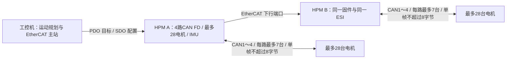

# HPM EtherCAT → ENCOS 电机控制协议升级实施方案

> 历史设计草案：正文的“现状”和“待实施”属于成文时状态，不能直接作为当前源码结论。当前文件职责见[目录清单](../current/PROJECT_LAYOUT.md)，设计资料状态见[索引](../design/README.md)。

版本：设计草案 V1.0；日期：2026-09-10。

本轮交付为实施方案及接口草案，未修改原固件、SSC 工程或烧录板卡。文中的“现状”来自本地代码和 ENCOS 手册；“建议/拟定”内容是待实施的新协议，不能直接作为已可用 ESI 导入。

## 1. 目标与总体决策

将 HPM 从“EtherCAT/CAN 原始帧透传器”升级为“ENCOS 电机控制网关”。工控机只处理模式、位置、速度、电流、状态等业务参数，HPM 处理 CAN ID、位打包、单位换算、反馈解码和运行互锁。电流环及电机原生伺服环仍在电机驱动器中；本期不在 HPM 再实现一套 PID。

本方案按以下规模设计：**每块HPM使用4路CAN FD，每路最多7台ENCOS电机，每板最多28台；两块板最多56台。** 四路都有完整电机PDO、SDO参数和原始帧透传能力，IMU数据接口保留。CAN ID只要求在同一路总线内唯一，不同通道可重复使用1～8。

建议第一版使用厂家自定义CoE对象字典，固定4×7个电机槽位；未安装的电机关闭配置，但保留其基础PDO空间。PDO承担周期控制和反馈，SDO承担配置、诊断及低频调试。暂不宣称CiA 402兼容：本方案使用自定义`ControlWord`和`StatusWord`，没有实现402状态机，不能直接绑定TwinCAT NC轴并期待自动工作。



### 1.1 “8 字节”必须分清的边界

你要求不使用 X1 的 64 字节电机数据帧，本方案保留 ENCOS 原生单电机报文，不把 8 台电机拼成一帧 64 字节 CAN FD。

但所提供的 V1.19EAP 手册规定：混控和位置命令为 8 字节，速度命令为 7 字节，电流/力矩命令为 3 字节，另有 2～8 字节管理报文。**默认按“每帧最多 8 字节、保持原生 DLC”执行。内存 data[8] 与线上 DLC 是两回事。**

若硬性要求所有周期控制报文 DLC=8：可先仅开放原生 8 字节的混控与位置模式；不能未经厂家确认把速度、电流报文补零到 8 字节。用混控参数模拟速度/电流控制会改变控制语义、反馈和限幅行为，不应当作原生模式的等价替代。严格 8 字节与完整开放原生速度/电流模式的冲突，必须在固件开发前解决。

同样，8 字节载荷既可以是经典 CAN，也可以是 CAN FD。手册第 7.1 节支持标准帧经典 CAN 1 Mbps，或 CAN FD+BRS 1/5 Mbps；电机通信模式需与 HPM 一致，不能仅因 HPM 外设支持 FD 就强制使用 FD。

## 2. 实际工程与现状核查

用户消息中的路径含转义式分隔，磁盘上实际找到的路径如下：

| 内容 | 实际路径 |
|---|---|
| 固件根目录，以下简记为 P | `E:\BOT_Procedure\BOT_ethercat_canfd_HPM_V1.0\HPM_ethercat_canfd_encos_V1.0` |
| SSC | `P\SSC` |
| 电机手册 | `E:\BOT_Procedure\BOT_ethercat_canfd_HPM_V1.0\Reference_Materials\因克斯电机相关资料\PDF协议文档\ENCOS+调试技术手册+V1.19EAP.pdf` |
| X1 本地参考根目录，以下简记为 X | `E:\BOT_Procedure\BOT_ethercat_canfd_HPM_V1.0\Reference_Materials\智元灵犀X1_DCU\agibot_x1_infer-main\agibot_x1_infer-main` |

### 2.1 已确认的实现

| 位置 | 当前行为 | 升级影响 |
|---|---|---|
| `P\application\ethercat_canfd_gateway.h` | 4 路 × 8 槽；每槽 16 B，含 ID/Flags/DLC/Seq/data[8]；每方向 576 B | 新版用每台电机的业务对象替换原始帧槽 |
| `P\application\ethercat_canfd_gateway.c` | 仲裁 1 Mbps、数据 5 Mbps；MCAN FD 开启，单帧 FDF/BRS 由透传标志决定 | 保留底层，帧属性改由受控的板级配置决定 |
| 同上 `receive_isr()` | 按收到顺序塞入每窗口最多 8 个槽 | 不能假定 Slot1 恒为电机1；须按 ID 路由到持久电机状态 |
| 同上 `map_output()`/`process()` | CycleSeq 连续 3 次不变停发；队列满不等待 | 增加独立时间看门狗、丢帧与过期队列处理 |
| 同上 `map_input()` | 发布一个接收窗口并清空下一窗口 | 改为持久反馈缓存 + 有效位 + 数据年龄 |
| `P\application\digital_io.c` | APPL 输入输出映射、周期函数和 OP 门控；固定 576 B | 此文件是 CMake 实际编译入口，不能只改 SSC/Src 下同名文件 |
| `P\SSC\Src\digital_ioObjects.h` | ApplicationObjDic 接入 `gatewayObjects.h` | SSC 重新生成时需要重新接入业务对象，避免旧网关条目残留 |
| `P\tools\generate_canfd_gateway.js` | 生成 `SSC/Src/gatewayObjects.h` 与 `SSC/ECAT_CANFD_GATEWAY.xml` | 现有映射主要由脚本维护，旧 digital_io.xlsx 并非完整网关定义来源 |
| `P\SSC\Src\ecat_def.h` | MAX_PD_INPUT/OUTPUT_SIZE=0x240；EXPLICIT_DEVICE_ID=1 | 更新大小并修复板卡身份配置 |
| `P\application\digital_io.c` | APPL_GetDeviceID() 固定返回 0x5 | 两块板都用 Explicit ID 匹配时会重复 |
| `P\ecat_config.h`、`port/hpm_ecat_e2p_emulation.c` | Flash 仿真 EEPROM；启用 Product/Revision 检查，必要时整份默认镜像重写 | 升级需处理 Alias/Serial 保留及 SII 同步 |

现有 ESI 的 SM0/SM1 分别从 0x1000/0x1080 开始，各 128 B；SM2 从 0x1100 开始，SM3 从 0x1800 开始，各 576 B。ESI 已包含 DC 模式（AssignActivate=0x300），但这不等于整条电机链路已实测同步。

### 2.2 X1 可借鉴的范围

本地 `X\src\module\dcu_driver_module\xyber_controller\xyber_api\include\internal\dcu.h` 中，DcuSendPacket 按 3 路组织，每路有 ctrl 和 data[64]；接口中有 EnableActuator、SetMode、SetPosition、SetVelocity、SetEffort 等。可借鉴“板卡 → 通道 → 电机”的对象组织及主站 API。

这部分是主站代码，不能据此认定 X1 的全部电机协议已经封装在 DCU 固件内，也不能照搬其 PDO 或电机载荷。本文是在 HPM 本地明确增加 ENCOS 编解码层。X1 官方项目参考：[DCU 模块说明](https://github.com/AgibotTech/agibot_x1_infer/blob/main/doc/dcu_driver_module/dcu_driver_module.zh_CN.md)。

## 3. ENCOS 协议适配规则

以下页码为 PDF 物理页；括号内为手册印刷页。

| 模式/功能 | 原生格式与长度 | HPM 的转换职责 | 来源 |
|---|---|---|---|
| 力位混控 | 3 bit 模式 + Kp12 + Kd9 + 位置16 + 速度12 + 前馈扭矩12，共 8 B | 按具体型号范围量化；不能套用普通 MIT 16/12/12/12/12 布局 | 第31页（26），9.1.1 |
| 伺服位置 | 模式3 + 位置 float32 + 速度上限 uint15 + 电流阈值 uint12 + ack2，共 8 B | rad→度；rad/s→rpm×10；A→0.1 A 原始计数；浮点跨字节位打包 | 第32页（27），9.1.2 |
| 伺服速度 | 首字节 + 速度 float32 + 电流阈值 uint16，共 7 B | rad/s→rpm；A→0.1 A 原始计数；预留控制状态必须为0 | 第32～33页（27～28），9.1.3 |
| 电流 | 首字节 + 有符号 int16，共 3 B | A×100；保留负号；选择正常电流子模式 | 第33～34页（28～29），9.1.4 |
| 力矩 | 首字节 + 有符号 int16，共 3 B | Nm×100；与电流模式区分，不将两者混用 | 同上 |
| 抱闸 | 有独立2 B命令及特定反馈 | 作为管理动作，依型号和机械流程执行 | 第34页（29），9.1.5 |
| 查询、设 ID、设零点 | 2～8 B，部分用0x7FF | 专用管理队列；不能当周期运动指令重发 | 第28～30页及43～46页 |

### 3.1 对工控机统一使用输出轴物理量

位置 rad，速度 rad/s，电流为相电流 A，扭矩 Nm，温度 °C；PDO 采用定长整数，缩放见第5节。位置默认是电机协议定义的输出端角度，额外机构减速比/关节零偏由工控机运动层处理。本期不自动扩展单圈为多圈位置；超范围必须拒绝或明确报告限幅。

转换公式：`deg = rad × 180/π`，`rpm = rad/s × 60/(2π)`；温度解码为 `(raw - 50)/2`。ENCOS 载荷多字节按高位在前组织；EtherCAT PDO 按小端组织。浮点通过 memcpy 到 uint32 后显式移位，避免未对齐访问及指针类型强转。

混控量化采用 `u = floor((x - xmin) × (2^n - 1)/(xmax - xmin))`，在有限值、上下界校验后执行；反量化按对应公式。本文选择截断约定以便与手册中间值示例核对，最终编解码测试要固定舍入规则，不允许主站和板卡各做一遍量化。

### 3.2 型号配置不能省略

手册第31页表9-1包含型号相关的电流、扭矩及 Kd 范围，部分型号 Kd 上限是50而非5。比如表中的 EC-A2806-P2-36 给出扭矩 ±12 Nm、电流 ±10 A、Kt=1.35；这只作表格差异的例子，**不认定实际所装电机就是此型号，也不能把协议满量程当作连续额定限值。**

每个槽位应配置 ModelProfileId、完整型号/固件版本对应的协议量化范围、Kt、运行电流上限、位置/速度限值、反馈策略和超时。未知型号或参数未确认时禁止使能。Kp/Kd 的量纲以厂家混控公式为准，工控机传入厂家物理增益，不能跨型号沿用未确认的默认值。

### 3.3 反馈策略

首版周期控制统一请求反馈类型1，混控天然只返回类型1。该类型一帧包含位置、速度、相电流、电机温度、MOS温度、错误码，满足主要实时参数需求（第44页/印刷39）。

类型2返回 float位置、电流和电机温度；类型3返回 float速度、电流和电机温度，均不是“全状态”。如果后续因精度或范围改用类型2/3交替，必须分别维护每个物理量的年龄；不得收到类型2就把旧速度也标为新。本文基础 PDO 的统一 FeedbackAgeMs 按最近完整类型1计算，类型2/3只更新扩展 SDO 诊断缓存，未扩展年龄接口前不切换基础 PDO 策略。

反馈按 `CAN ID + 报文类型 + DLC` 解析；0x7FF 回复另按载荷内目标 ID 路由。检查 IDE/RTR、帧格式、长度、未知 ID 和预留位。错误报文仍更新错误状态和在线性；“有反馈”不等于“无故障”。类型1的电流量化使用电流范围，不使用混控命令的扭矩范围。

手册某些配置返回描述、ack 示例及第11节混控示例与前文范围存在不一致，不能把所有示例都作为正确编码的金标准。控制位表优先结合厂家例程和实测确认；发生冲突的命令不开放给运行模式。

## 4. HPM 固件改造

### 4.1 文件职责与修改顺序

| 文件/位置 | 计划改动 |
|---|---|
| `application/ethercat_canfd_gateway.c/.h` | 复用4路MCAN初始化、收发、LED和原始帧槽；增加统一分发器、通道角色、共享轻量透传和维护期全带宽透传 |
| 新增 `application/encos_motor.c/.h` | ENCOS 编解码、型号表、单位换算、报文验证、管理命令格式；独立于 SSC，便于桌面测试 |
| 新增 `application/motor_control.c/.h` | 固定4×7槽状态、PDO快照校验、控制权、超时、分通道周期调度和反馈发布 |
| `application/digital_io.c` | 接入新的 Start/Stop、GenerateMapping、Input/OutputMapping、Application；修复 DeviceID |
| `ecat.c` | 初始化1路CAN和电机配置；将独立时间检查接入已有1 ms节拍；确保 CAN_LED_TEST 关闭 |
| `SSC/Src` | 生成业务对象、SDO访问回调和映射，保留厂家栈许可头，不修改通用栈实现来凑业务逻辑 |
| `tools/generate_canfd_gateway.js` | 升级或替换为电机映射生成工具；旧脚本不能再覆盖新版字典 |
| `port/hpm_ecat_e2p_emulation.c` | SII版本迁移时保留/恢复Alias和Serial，重新校验配置区CRC；独立保存电机配置 |
| `CMakeLists.txt` | 注册新源文件，保持一个实际应用映射实现，不重复编译两个digital_io.c |

这里最多新增两个业务模块，无需先引入 RTOS、通用驱动框架或动态分配。先在新版本副本/分支实施并保留可回退的 V1.0 镜像。

### 4.2 周期链路

1. `APPL_OutputMapping()` 仅复制本周期完整 PDO 到候选缓冲。
2. 在已确定的 SSC 应用同步点验证 CycleSeq、版本、控制权、启用掩码及各槽参数，将合法候选原子提交到 active command。
3. 四路调度器分别把本路已配置且获授权的8个槽生成原生ENCOS命令；每电机每控制周期至多一条周期控制帧。相同目标也要按周期刷新，不能沿用ON_CHANGE后长期不发；四个MCAN可并行，单路内部仍串行。
4. 各MCAN RX中断只将channel、ID、DLC、载荷和时间戳存入本路有界接收队列；统一分发器读取一次后，按通道+ID更新电机持久状态，并按配置镜像到原始透传队列。建议每路初始32条软件队列，按最大帧率和最长服务间隔核定，溢出计数分路可读。
5. `APPL_InputMapping()` 发布完整稳定快照，包括未更新电机的旧值、有效位和持续增长的数据年龄。不能按接收先后改变槽位。

控制快照、SDO配置、CAN反馈之间采用短临界区或双缓冲，发布时避免撕裂；不在 SSC/MCAN ISR 里等待反馈、sleep、写Flash或大量printf。恢复中断应还原先前屏蔽状态，不盲目开中断。

### 4.3 最小状态机

`UNCONFIGURED → DISABLED → READY → ACTIVE`，异常进入 `FAULT_LATCHED`。READY要求型号配置完整、目标总线正常、收到有效反馈、无电机故障。首次启动可用非致动查询返回确认在线，并通过查询位置/速度等必要数据准备初值，不要求先发送运动命令才能READY。ACTIVE还要求 EtherCAT OP、合法且新鲜的控制租约、主站使能请求和相应槽位Enable。

启动查询值保存于服务结果/诊断缓存并带各自时间戳；主站用它们准备首次位置目标。基础PDO仍坚持完整类型1有效性规则，不把查询到的单个位置伪装成一帧全量反馈。进入ACTIVE后须在反馈超时窗口内获得完整类型1，否则停用该槽。

模式切换先停用该电机，提交新模式及安全初值，再以一次新的使能边沿进入ACTIVE。位置模式的初值由主站根据新鲜反馈设置，避免默认0位置引起跳转。失联、bus-off和重启后不能自动恢复旧目标。

HPM的Enable表示“允许下发运动命令”，不是厂家驱动已确认上电使能。手册不提供通用402使能握手，不能编造 `EnableConfirmed`；状态只报告软件许可、CAN发送结果和实际可观测反馈。抱闸有独立流程，不能简单把Enable位反相当抱闸控制。

### 4.4 超时及停机

现有“CycleSeq不变3次”依赖输出映射继续被调用，不能覆盖所有断帧情形。新方案同时检查 ESC SM看门狗、OP状态，以及独立单调时钟记录的“最后有效新命令时间”。周期计数与实际时间监测各司其职。

建议初始验证值：CAN调度周期2 ms；命令租约10 ms；完整反馈超时20 ms。它们是调试起点，必须由台架延迟、主站调度和机构停机需求确认，不能当安全性能承诺。配置范围需限制到已验证集合，运行期不允许任意扩大租约。

超时处理：撤销控制许可、清除软件待发命令、取消尚未发送的旧MCAN帧、锁存原因；如总线仍可用，依据已验证 StopPolicy 发送有限次数停机/制动动作，再停止周期运动命令。bus-off时无法保证停机帧送达，电机自身非零CAN超时保护必须同时启用。厂家默认500 ms不能直接视为满足系统停机要求。

“停发”“零电流”“速度归零”“保持位置”“闭合抱闸”效果不同；承重机构需按电机及机械设计确定StopPolicy。不会把零电流标注为断能，也不会在电机未减速时默认闭合抱闸。该通信控制接口不属于经认证的安全功能。

### 4.5 队列、发送完成与诊断

使用有截止时间的最新命令，不能让旧轨迹在TX FIFO积压后补发。队列满记录 TxDropCount；下一调度前检查上一批完成情况，超预算则丢弃过期请求并报告超期。停止时取消请求后还要确认取消/发送完成状态，已经发上总线的帧无法撤回。

AcceptedCycleSeq只表示HPM完成了命令校验与提交；入硬件队列、发送完成、收到反馈分别记录。ENCOS反馈不携带主站序号，因此不能把某个反馈宣称为该PDO的精确执行确认。发布的ModeDisplay也是HPM当前使用的模式，不是驱动回读模式。

## 5. 工控机 PDO 接口定义草案

### 5.1 公共约定

RxPDO：主站→HPM；TxPDO：HPM→主站。所有偏移单位为字节，均以各自方向的过程映像起点为0，小端、连续排列、无隐式填充。`UINT8/16/32`为无符号，`INT16/32`为有符号；CoE使用对应标准基础数据类型。

为支持28轴并适配当前ESC过程RAM，基础对象改成紧凑布局：板级Rx/Tx各32 B，每路通道Rx/Tx各8 B，单电机Rx 24 B、Tx 32 B，IMU Tx 64 B。TargetCurrent、Kp、Kd、CurrentLimit、ActualCurrent、MotorFaultRaw、BridgeFaultCode、FeedbackAgeMs和PowerAgeMs按ENCOS协议实际范围压缩；板级仍保留空间，后续每电机扩展采用独立可选Extension PDO，从而保持基础字段偏移不变。

推荐发布三个Assignment配置档：

| 配置档 | RxPDO | TxPDO | 用途 |
|---|---:|---:|---|
| RUN_BASE | 736 B | 1024 B | 28电机+IMU，不含原始帧槽 |
| RUN_MIXED（推荐默认） | 784 B | 1072 B | 28电机+IMU+跨四路共享的2个透传槽 |
| GATEWAY_FULL | 544 B | 544 B | 关闭电机业务和IMU周期区，四路各7个透传槽 |

RUN_MIXED是“每一路都能透传”，但共享槽限制整板每周期最多下发2帧、上报2帧；通过Channel字段选择CAN1～4并由HPM轮询公平服务。它用于在线诊断和少量附加设备。若需要四路同时高吞吐透传，切换到GATEWAY_FULL。不能把四路各7槽全带宽透传同时叠加到28轴运行映像。

定义全局轴号 `a=0…27`，`channel=a/7`，`slot=a%7`。CAN ID只在所属channel内唯一。下行电机对象使用0x7200～0x721B，上行电机对象使用0x6200～0x621B；PDO轴顺序固定为CAN1槽1～7、CAN2槽1～7、CAN3槽1～7、CAN4槽1～7。

### 5.2 板级 RxPDO：0x7000，32 B

| 子索引 | 偏移 | 名称 | 类型 | 含义 |
|---|---:|---|---|---|
| 01 | 0 | CycleSeq | UINT32 | 主站每周期递增，模2^32；同序号不续租 |
| 02 | 4 | BoardControl | UINT16 | bit0 RunPermit；bit1 StopRequest；bit2 ResetBridgeFault边沿；其他为0 |
| 03 | 6 | ChannelEnableMask | UINT8 | bit0～3对应CAN1～4；高4位必须0 |
| 04 | 7 | Reserved0 | UINT8 | 必须0 |
| 05 | 8 | CommandLeaseMs | UINT16 | 请求租约；必须非0且≤SDO配置上限 |
| 06 | 10 | Reserved1 | UINT16 | 必须0 |
| 07 | 12 | InterfaceVersion | UINT32 | 首版拟定0x00010000；不匹配不接受控制 |
| 08 | 16 | AxisEnableMask | UINT32 | bit0～27对应全局轴0～27，bit28～31保留为0；再与各通道ActiveMask及SDO配置取交集 |
| 09 | 20 | Reserved2 | UINT32 | 首版必须0，供后续板级控制扩展 |
| 0A | 24 | Reserved3 | UINT32 | 首版必须0，供后续板级控制扩展 |
| 0B | 28 | Reserved4 | UINT32 | 首版必须0，供后续板级控制扩展 |

同序号不能续租；以模运算判断新旧序号，旧序号不得倒灌。OP重新进入后开启新会话、丢弃旧活动目标，必须先提交禁用快照再使能。StopRequest和RunPermit撤销优先执行，不能因同序号或普通目标校验失败而忽略停止意图。

### 5.3 每路CAN RxPDO：0x7100～0x7103，每路8 B

| 子索引 | 偏移 | 名称 | 类型 | 含义 |
|---|---:|---|---|---|
| 01 | 0 | ChannelControl | UINT16 | bit0 RunPermit；bit1 StopRequest；其他为0 |
| 02 | 2 | ActiveMask | UINT8 | bit0～6对应本路7个电机槽，bit7保留为0 |
| 03 | 3 | ExpectedRole | UINT8 | 0禁用、1电机、2透传、3混合；必须与SDO已应用角色一致 |
| 04 | 4 | Reserved | UINT32 | 首版必须0 |

### 5.4 单电机 RxPDO：24 B

电机区起始偏移64，轴 `a` 起始偏移为 `64 + 24*a`，以下为槽内偏移。

| 子索引 | 偏移 | 名称 | 类型 | 单位/语义 |
|---|---:|---|---|---|
| 01 | 0 | ControlWord | UINT16 | bit0 Enable；bit1 Stop；bit2 ResetLocalFault边沿；其他0 |
| 02 | 2 | Mode | UINT8 | 0 Disabled，1 Position，2 Velocity，3 Current，4 Hybrid，5 Torque |
| 03 | 3 | Flags | UINT8 | 首版保留，必须0 |
| 04 | 4 | TargetPosition | INT32 | 10^-6 rad |
| 05 | 8 | TargetVelocity | INT32 | 10^-6 rad/s；位置模式为非负速度上限 |
| 06 | 12 | TargetTorque | INT32 | mNm；力矩模式目标/混控前馈 |
| 07 | 16 | TargetCurrent | INT16 | 0.01 A；电流模式有效，范围-327.68～327.67 A |
| 08 | 18 | Kp | UINT16 | 厂家物理增益×100；混控有效，0～655.35 |
| 09 | 20 | Kd | UINT16 | 厂家物理增益×1000；混控有效，0～65.535 |
| 0A | 22 | CurrentLimit | UINT16 | 0.1 A；位置/速度模式电流阈值，必须大于0且≤配置上限 |

该Mode枚举是HPM接口定义，不等同ENCOS帧的3 bit模式值。未使用目标字段写0；位置模式的TargetVelocity是限速，混控中才是期望速度，避免主站理解混淆。

Hybrid只使用位置、速度、前馈扭矩、Kp/Kd。它没有可逐帧传给驱动的CurrentLimit字段，不能谎称这一字段能硬限制混控实际电流；其电流保护依赖驱动已配置限值及反馈监视。第一版Hybrid要求CurrentLimit=0，独立使用SDO配置的保护上限。

参数越界默认拒绝该槽新目标、撤销该槽运行许可并锁存原因，不静默使用上一条运动目标。板级版本、长度或控制头非法时拒绝整板控制。TargetCurrent和TargetTorque同时填写但模式不支持时按非零无效字段拒绝，降低误用概率。

### 5.5 板级 TxPDO：0x6000，32 B

| 子索引 | 偏移 | 名称 | 类型 | 含义 |
|---|---:|---|---|---|
| 01 | 0 | PublishSeq | UINT32 | 每次发布快照递增 |
| 02 | 4 | AcceptedCycleSeq | UINT32 | 最近已接受的PDO控制头序号；各槽是否可运行另看BoardStatus |
| 03 | 8 | BoardStatus | UINT16 | bit0配置就绪，bit1 OP，bit2命令超时，bit3 bus-off，bit4 RX溢出锁存，bit5 TX超期锁存，bit6接口错误，bit7 SDO控制权 |
| 04 | 10 | ChannelOnlineMask | UINT8 | bit0～3对应CAN1～4 |
| 05 | 11 | ChannelFaultMask | UINT8 | bit0～3对应CAN1～4 |
| 06 | 12 | AxisOnlineMask | UINT32 | bit0～27对应全局轴0～27，bit28～31保留为0 |
| 07 | 16 | AxisFaultMask | UINT32 | 电机故障或HPM本地轴故障 |
| 08 | 20 | RxDropCount | UINT32 | 四路累计接收溢出/丢弃；细分类通过通道PDO及SDO读 |
| 09 | 24 | TxDropCount | UINT32 | 四路累计发送丢弃/过期计数 |
| 0A | 28 | Reserved | UINT32 | 首版返回0，供后续板级状态扩展 |

### 5.6 每路CAN TxPDO：0x6100～0x6103，每路8 B

| 子索引 | 偏移 | 名称 | 类型 | 含义 |
|---|---:|---|---|---|
| 01 | 0 | ChannelStatus | UINT16 | bit0配置有效，bit1运行，bit2 bus-off，bit3 RX溢出，bit4 TX过期 |
| 02 | 2 | OnlineMask | UINT8 | 本路7个电机在线位图，bit7保留为0 |
| 03 | 3 | FaultMask | UINT8 | 本路7个电机故障位图，bit7保留为0 |
| 04 | 4 | RxDropCount | UINT16 | 本路接收丢弃计数，饱和 |
| 05 | 6 | TxDropCount | UINT16 | 本路发送丢弃/过期计数，饱和 |

### 5.7 单电机 TxPDO：32 B

电机区起始偏移64，轴 `a` 起始偏移为 `64 + 32*a`。

| 子索引 | 偏移 | 名称 | 类型 | 单位/语义 |
|---|---:|---|---|---|
| 01 | 0 | StatusWord | UINT16 | 见下方位定义 |
| 02 | 2 | ModeDisplay | UINT8 | HPM活动模式，与Rx Mode枚举一致 |
| 03 | 3 | ValidFlags | UINT8 | 字段有效性，不等同本周期更新 |
| 04 | 4 | ActualPosition | INT32 | 10^-6 rad |
| 05 | 8 | ActualVelocity | INT32 | 10^-6 rad/s |
| 06 | 12 | EstimatedTorque | INT32 | mNm，由电流和已确认Kt估算；非扭矩传感器实测 |
| 07 | 16 | ActualCurrent | INT16 | 0.01 A，相电流，范围-327.68～327.67 A |
| 08 | 18 | MotorTemperature | INT16 | 0.1 °C |
| 09 | 20 | MosTemperature | INT16 | 0.1 °C |
| 0A | 22 | MotorFaultRaw | UINT8 | ENCOS原始错误码0～7；本地故障不混入此字段 |
| 0B | 23 | BridgeFaultCode | UINT8 | HPM故障码0～255 |
| 0C | 24 | ActualPower | INT32 | mW；来自查询码4，不是HPM根据电流估算值 |
| 0D | 28 | FeedbackAgeMs | UINT16 | 最近完整类型1反馈年龄，单位ms，饱和到65535；未获得时0xFFFF |
| 0E | 30 | PowerAgeMs | UINT16 | 最近有效功率查询结果年龄，单位ms，饱和到65535；未获得时0xFFFF |

StatusWord：bit0 Configured；bit1 Online；bit2 Ready；bit3 CommandActive（软件允许控制）；bit4 NewFeedback（相对上次PDO发布的新类型1反馈）；bit5 BridgeFault；bit6 MotorFault；bit7 FeedbackStale；bit8 CommandRejected；bit9 StopLatched；bit10 NewPower；bit11 PowerStale；其余保留0。

ValidFlags：bit0位置、bit1速度、bit2电流、bit3估算扭矩、bit4电机温度、bit5MOS温度、bit6功率；bit7保留0。初始全部无效；超时后保留最后数值但清除对应有效位并置Stale。Kt未知时扭矩有效位始终为0。主站读取功率必须同时检查bit6和PowerAgeMs，读取其他实时量则检查相应有效位和FeedbackAgeMs，不能把初始0当真实反馈。

功率不在ENCOS类型1周期反馈中，而是通过查询码4获得。HPM应把查询结果转换为mW并同步到ActualPower，但它的更新时间由CAN调度预算决定，不能默认等于位置、速度和电流的更新率。建议在SDO中为每台电机配置PowerQueryPeriodMs，初始从50～100 ms验证；设0表示不主动查询，ValidFlags.bit6保持0。每路7台分别错峰，四路MCAN可并行执行；周期控制帧优先，查询超期时保留旧值、增加PowerAgeMs并置PowerStale。

### 5.8 IMU TxPDO：0x6300，64 B

| 子索引 | 偏移 | 名称 | 类型 | 单位/语义 |
|---|---:|---|---|---|
| 01 | 0 | SampleSeq | UINT32 | 每次完整采样递增 |
| 02 | 4 | Status | UINT16 | 传感器、通信、校准和同步状态 |
| 03 | 6 | ValidFlags | UINT16 | 加速度、角速度、四元数、温度、时间戳有效位 |
| 04 | 8 | TimestampNs | UINT64 | 实际采样时间；优先使用DC同步后的本地时间 |
| 05～07 | 16 | AccelX/Y/Z | 3×INT32 | μm/s² |
| 08～0A | 28 | GyroX/Y/Z | 3×INT32 | μrad/s |
| 0B～0E | 40 | QuaternionW/X/Y/Z | 4×INT32 | Q30定点数 |
| 0F | 56 | Temperature | INT16 | 0.01°C |
| 10 | 58 | Reserved0 | UINT16 | 首版0 |
| 11 | 60 | Reserved1 | UINT32 | 首版0 |

IMU量程、滤波、安装方向、零偏和校准命令使用SDO。若后续确实需要周期触发，可通过独立IMU Rx扩展PDO增加，不占用现有电机字段。TimestampNs表示采样时刻，不是EtherCAT发送时刻；未完成DC同步时必须清除相应有效位。

### 5.9 RUN_MIXED共享透传PDO：0x7300/0x6400，各48 B

每个方向由16 B批次头和2个16 B原始帧槽组成。下行0x7300由工控机写入，映射为RxPDO；上行0x6400由HPM发布，映射为TxPDO。

批次头：BatchSeq UINT32、ValidMask UINT8、SlotCount UINT8、Flags UINT16、DropCount UINT32、Reserved UINT32。单槽：CanId UINT32、Channel UINT8（0～3）、Flags UINT8、Dlc UINT8、Reserved UINT8、Data[8]。单帧只支持DLC 0～8。

两个槽由四路共享，并不绑定某一路。发送按停止/故障、电机周期控制、电机必要查询、共享透传的顺序调度；接收按四路轮询公平选取，未上报帧保留在有界软件队列或在溢出时计数。Mixed角色下禁止原始透传发送本路已配置电机ID及0x7FF，避免绕过电机控制和维护互锁；电机报文可只读镜像到上行透传槽。

### 5.10 GATEWAY_FULL四路全带宽透传PDO

维护配置档复用现有网关格式，每路每方向128 B：16 B总线头+7×16 B帧槽，四路合计512 B；加32 B板头后每方向544 B。建议对象为下行0x7400/0x7410/0x7420/0x7430，上行0x6500/0x6510/0x6520/0x6530。

GATEWAY_FULL进入OP前关闭电机业务PDO和IMU周期PDO；切换配置档仅允许在PREOP。这样完整保留四路各7槽透传能力，又不会把全带宽透传长期叠加到28轴实时控制过程映像。

BridgeFaultCode拟定：0正常；1配置不完整；2参数越界；3命令超时；4反馈超时；5总线关闭；6发送超期；7协议格式不符；8控制权冲突；9接口版本错误。多个故障同时存在时保留首个锁存原因，详细活动故障位图通过SDO读取。

## 6. SDO 对象与控制权

### 6.1 对象分配

上一版这里只给出了通用 `MotorConfig` 和 `MotorService(Opcode, Argument)`，**没有覆盖手册的全部电机配置和查询参数**。特别是双值的混控范围、两参数PID以及40个分段Kt，无法用单个Argument可靠表达。下面修订为明确的分组对象。

以下为自定义对象；所有Record的`:00`为最大子索引，UINT8、只读，不映射PDO。全局轴 `a=0…27` 的参数基地址为 `B=0x3000+0x10*a`，即轴0使用0x3000～0x3008，轴7使用0x3070～0x3078，轴27使用0x31B0～0x31B8。配置写入先进入HPM的RAM候选区，经校验和显式事务才发送给电机；不能在每次SDO写对象时直接发CAN或写Flash。

| 对象 | 子索引与类型 | 权限/用途 |
|---|---|---|
| 0x2000 BoardInfo | 01 InterfaceVersion U32；02 FirmwareVersion U32；03 BoardRole U16；04 ConfigGeneration U32；05 Capabilities U32 | RO；BoardRole来自本机独立配置 |
| 0x2001 BoardConfig | 01 AxisConfiguredMask U32；02 MaxCommandLeaseMs U16；03 FeedbackTimeoutMs U16；04 ActivePdoProfile U8（0 RUN_BASE、1 RUN_MIXED、2 GATEWAY_FULL） | 01～03在PREOP且整板禁用时RW；04只读，由0x1C12/0x1C13实际组合判定，非法组合拒绝进入SAFEOP |
| 0x2010～0x2013 ChannelConfig | 01 Role U8（0禁用、1电机、2透传、3混合）；02 FrameFormat U8（0经典、1 FD+BRS）；03 NominalBitrate U32；04 DataBitrate U32；05 ScheduleUs U32；06 RawRateLimit U16；07 MotorConfiguredMask U8 | 分别对应CAN1～4；同一路最多配置7个CAN ID且必须唯一 |
| 0x2002 ConfigAction | 01 ApplyGeneration U32；02 SaveToken U32；03 Result U16；04 AppliedGeneration U32 | 01/02 WO，03/04 RO；异步操作，明确Busy/成功/错误；SaveToken用固定授权常量并校验状态 |
| 0x2200+0x10*a SdoCommand | 01～0A字段与单电机RxPDO完全同型同义；0B CommitSeq U32；0C LeaseMs U16；0D AcceptedSeq U32；0E CommandResult U16 | 轴0～27；01～0C RW，0D/0E RO；无PDO映射；CommitSeq最后写 |
| 0x2400+0x10*a MotorDiag | 01 TxEnqueueCount U32；02 TxCompleteCount U32；03 TxDropCount U32；04 RxValidCount U32；05 ProtocolErrorCount U32；06 ActiveFaultBits U32；07 LastServiceError U32；08 QueriedPosition I32；09 PositionQueryAgeUs U32；0A QueriedVelocity I32；0B VelocityQueryAgeUs U32 | 轴0～27，RO；查询值单位同PDO，未获得时年龄0xFFFFFFFF；计数重启清零，活动故障位实时更新 |
| 0x2003 ControlOwner | 01 Owner U8（0无/1PDO/2SDO）；02 RequestedOwner U8；03 Result U16 | 01/03 RO，02 RW；仅禁用时切换，切换清空全部活动目标 |
| B+0 MotorRoutingAndLimits | 01 CanId U16；02 ModelProfileId U16；03 PositionLimitMin I32；04 PositionLimitMax I32；05 VelocityLimit U32；06 CurrentLimit U32；07 TorqueLimit U32；08 StopPolicy U8；09 FeedbackPolicy U8；0A PowerQueryPeriodMs U16 | HPM本地路由、安全限值和功率查询周期；单位同PDO；不直接等于驱动器内部参数 |
| B+1 MotorBasicParameter | 01 AccelerationRaw U16；02 CommunicationMode U8；03 TorqueConstantRaw U16；04 CanTimeoutMs U16；05 ZeroOffsetRaw I16；06 BrakeEnable U8 | 电机原生配置候选值；具体比例见6.1.1 |
| B+2 MotorHybridRange | 01 KpMin U16；02 KpMax U16；03 KdMin U16；04 KdMax U16；05 PosMinRaw I16；06 PosMaxRaw I16；07 SpdMinRaw I16；08 SpdMaxRaw I16；09 TorMinRaw I16；0A TorMaxRaw I16；0B CurMinRaw I16；0C CurMaxRaw I16 | 完整对应六组力位混控协议量化范围 |
| B+3 MotorLoopGain | 01 CurrentKpRaw U16；02 CurrentKiRaw U16；03 SpeedKpRaw U16；04 SpeedKiRaw U16；05 PositionKpRaw U16；06 PositionKdRaw U16 | 电流PI、速度PI、位置PD；比例见6.1.1 |
| B+4 MotorKtSegment | 01 Group U8；02 Kt1Raw U16；03 Kt2Raw U16；04 Kt3Raw U16；05 Kt4Raw U16；06 CalibrationMode U8 | 一次读写一组；Group=1～10，共40个Kt；每个值实际量=Raw/100 |
| B+5 MotorQueryValue | 01 PositionDeg REAL32；02 SpeedRpm REAL32；03 PhaseCurrentA REAL32；04 PowerW REAL32；05 AccelerationRaw U16；06 BrakeState U8；07 EncoderOutputEnabled U8；08 EncoderOriginalRaw I16；09 EncoderCalibratedRaw I16；0A ZeroOffsetRaw I16；0B ValidBits U32；0C SnapshotSeq U32；0D AgeMs U32 | 查询结果缓存；角度原始查询字段比例见手册，ValidBits逐项标明有效性 |
| B+6 MotorIdentity | 01 UuidPart1 U32；02 UuidPart2 U32；03 UuidPart3 U32；04 HardwareVersion0 U8；05 HardwareVersion1 U8；06 HardwareVersion2 U8；07 SoftwareVersion0 U8；08 SoftwareVersion1 U8；09 SoftwareVersion2 U8 | 只读缓存；UUID由连续三帧组装，只有三帧齐全后才更新有效状态 |
| B+7 MotorParameterTransaction | 01 ParameterId U16；02 Operation U8；03 RequestSeq U32；04 DoneSeq U32；05 Result U16；06 DirtyBits U32；07 RawResponseLength U8；08 RawResponse OCTET_STRING[8] | Operation：1读取、2写入、3读后校验、4读取全部；异步执行，写操作仅维护状态允许 |
| B+8 MotorMaintenance | 01 Opcode U16；02 Argument0 I32；03 Argument1 I32；04 RequestSeq U32；05 DoneSeq U32；06 Result U16；07 RawResponse OCTET_STRING[8] | 设零点、查询/设置/重置CAN ID、抱闸等非普通参数事务 |

类型简称U/I分别是UINT/INT，REAL32是IEC 61131-3单精度浮点，OCTET_STRING是原始字节数组。表列参数的上限不能仅按整数存储范围放行：必须同时满足协议范围、具体型号运行范围和本机已验证范围。CanId只允许合法电机标准ID，首版每路电机CAN ID仍允许1～8，但最多配置7个且必须唯一，禁止0和专用0x7FF；同一路重复ID拒绝Apply，不同CAN通道可重复。

ModelProfile仍用于提供厂家已确认的初始值和硬性安全边界，但现在允许在维护状态通过B+1～B+4明确读取、修改电机参数。用户写入的是候选值；只有事务Result成功且按查询结果校验一致，才更新“已应用值”。电机实际参数与HPM缓存不能混为一谈。

#### 6.1.1 电机协议配置参数完整覆盖表

| ParameterId | 手册配置码 | 参数 | SDO候选字段 | 原生比例/长度 | 可查 |
|---:|---:|---|---|---|---|
| 1 | 0x01 | 加速度 | B+1:01 | Raw/100 rad/s²；4 B | 查询码5 |
| 2 | 0x02 | 通信模式 | B+1:02 | 0经典CAN，1 CAN FD；3 B；重启生效 | 手册配置回复/查询表未列独立查询码，写后读回复并在重启后通信验证 |
| 3 | 0x04 | 扭矩系数Kt | B+1:03 | Raw/100；4 B | 查询码22 |
| 4 | 0x05 | 混控KP范围 | B+2:01～02 | MIN、MAX均比例1；6 B | 查询码23 |
| 5 | 0x06 | 混控KD范围 | B+2:03～04 | MIN、MAX均比例1；6 B | 查询码24 |
| 6 | 0x07 | 混控POS范围 | B+2:05～06 | int16，Raw/100 rad；6 B | 查询码25 |
| 7 | 0x08 | 混控SPD范围 | B+2:07～08 | int16，Raw/100 rad/s；6 B | 查询码26 |
| 8 | 0x09 | 混控TOR范围 | B+2:09～0A | int16，Raw/10 Nm；6 B | 查询码27 |
| 9 | 0x0A | 混控CUR范围 | B+2:0B～0C | int16，Raw/10 A；6 B | 查询码28 |
| 10 | 0x0B | CAN超时 | B+1:04 | ms，比例1；4 B；0会关闭保护，默认拒绝写0 | 查询码31 |
| 11 | 0x0C | 电流环PI | B+3:01～02 | CurrentKp=Raw/10000，CurrentKi=Raw/10；6 B | 查询码32 |
| 12 | 0x0D | 速度环PI | B+3:03～04 | SpeedKp、SpeedKi均Raw/100000；6 B | 查询码33 |
| 13 | 0x0E | 位置环PD | B+3:05～06 | PositionKp、PositionKd均Raw/100000；6 B | 查询码34 |
| 14 | 0x0F | Kt校准使能 | B+4:06 | 0关闭、1单表、2双表；3 B | 查询码35 |
| 15 | 0x10 | Kt分段系数 | B+4:01～05 | 组1～10，每组4个uint12，Raw/100；8 B | 查询码36，必须携带组号 |
| 16 | 0x11 | 零位偏置角 | B+1:05 | int16，Raw/100°；手册正文称3 B但示例/字段合计为4 B，实施前以厂家或实测确认 | 查询码38 |

手册没有配置码0x03。不能根据编号连续性自行补一个不存在的功能。BrakeEnable不是9.2参数配置码，它走抱闸专用命令，字段放在B+1只是方便维护界面暂存，实际由B+8事务执行。

“混控范围”有两层含义，必须分开：B+2是**写入电机、决定12/9/16/12/12位量化映射的协议范围**；B+0中的Position/Velocity/Current/Torque Limit是**HPM运行安全限值**。安全限值必须位于协议范围及电机型号允许范围内，修改B+2后HPM要重新读取六组范围、重建量化系数，并拒绝仍使用旧范围编码的活动命令。

PID/PI/PD属于电机驱动器内部控制环参数，适合SDO维护，不进入周期PDO。修改只允许在电机停用、无运动命令、整板处于维护控制权时进行；写后立即用对应查询码32～34读回比较。这里的CurrentKp等字段保存协议原始整数，避免REAL32舍入导致写回变化；上位机根据表中比例显示实际数值。

#### 6.1.2 查询参数完整覆盖表

| 查询码 | 查询内容 | 保存位置/处理 |
|---:|---|---|
| 1 | 当前输出端位置，float，角度制 | B+5:01，同时可换算到PDO的rad位置 |
| 2 | 当前速度，float，RPM | B+5:02，同时可换算到PDO的rad/s速度 |
| 3 | 当前相电流，float | B+5:03 |
| 4 | 当前功率，float | B+5:04，同时转换为mW发布到TxPDO ActualPower；有效性和年龄独立管理 |
| 5 | 当前加速度 | B+5:05，同时更新B+1:01的已应用值 |
| 22 | 当前扭矩系数Kt | 更新B+1:03已应用值 |
| 23～28 | KP、KD、POS、SPD、TOR、CUR六组混控范围 | 更新B+2相应已应用值，保留符号和原生比例 |
| 29 | MCU UUID，连续三帧 | B+6:01～03；三帧按编号组装，缺一帧则整组无效 |
| 30 | 硬件与软件版本号，各3字节 | B+6:04～09 |
| 31 | CAN超时保护时间 | 更新B+1:04已应用值 |
| 32 | 电流环KP、KI | 更新B+3:01～02 |
| 33 | 速度环KP、KI | 更新B+3:03～04 |
| 34 | 位置环KP、KD | 更新B+3:05～06 |
| 35 | Kt校准模式 | 更新B+4:06 |
| 36 | 指定组Kt分段系数 | 更新B+4:02～05；上位机逐组读取1～10 |
| 37 | 抱闸状态 | B+5:06 |
| 38 | 零位偏置角 | B+5:0A并更新B+1:05 |
| 39 | 编码器角度、使能、原始角度、校准角度 | B+5:07～09 |

查询码6～21在当前V1.19EAP手册中未定义，不能发送。查询码1～5以及22～39都由 `B+7 Operation=1` 发起，ParameterId使用上表的规范化编号或查询专用编号；HPM内部再转换为ENCOS查询码，工控机不直接拼CAN字节。

位置、速度、电流等既能通过问答类型1周期反馈获得，也能主动查询。PDO实时反馈以类型1状态缓存为准；B+5主动查询主要用于维护、初始化和交叉验证，不能每个EtherCAT周期对每路7台电机逐项查询，否则会挤占CAN控制带宽。

#### 6.1.3 非9.2参数类维护命令

B+8还应明确支持：查询CAN ID、设置CAN ID、重置CAN ID、设置当前点为零点（无偏置/带偏置）、抱闸开关，以及手册中经确认的其他一次性维护命令。设置ID和查询未知ID使用0x7FF专用标识符，必须单电机接入维护，防止多电机同时响应。

这些命令不是PID或普通配置Record的一部分，仍使用RequestSeq/DoneSeq/Result完成异步事务。手册要求设置通信模式、设置当前点为零点、设置电机ID后延迟至少500 ms再发下一条CAN指令，HPM用状态机计时，不能在SDO回调中阻塞500 ms。

### 6.2 PDO与SDO不能同时争抢目标

正常运行Owner=PDO，SDO写SdoCommand提交运动命令返回控制权错误；SDO诊断读取仍允许。SDO调试时先禁用、切换Owner=SDO，写完整参数及LeaseMs，最后写新的CommitSeq，HPM原子复制到命令队列，轮询AcceptedSeq/CommandResult确认接受。

即便主站不用运动PDO，SDO运动仍要求EtherCAT OP，并保持有效周期通讯/SM看门狗；SDO不能绕过OP门控。SDO控制沿用相同限幅、故障和停机路径。租约不自动无限续期，必须重新提交新序号；可允许专门的调试租约上限，例如100 ms，但需台架验证且不能默认为无超时。

普通SDO写成功只表示HPM收到了对象值。Commit结果才表示本地校验接受；服务DoneSeq/Result才表示对应CAN事务的结果，不能将其与电机已到达位置混为一谈。

参数读写使用SDO访问回调检查状态与范围，返回标准CoE abort（只读写入、索引不存在、类型长度错误、值越界、当前状态不允许），再以CommandResult暴露业务错误。不得在SDO回调里同步等待CAN应答。

### 6.3 SDO缓存一致性与管理事务

当前原始PDO变量与对象字典存储是不同缓冲，新版必须显式同步：周期快照同时作为PDO和状态对象SDO的读取来源；SDO读目标对象返回最后接受值，不返回未提交草稿。分多次SDO读取全状态时先后读板级Seq，变化则重试，或提供一次性快照读取。

参数与维护命令每路CAN至多一个在途事务，四路可并行；事务关联channel、slot、CAN ID、B+7 ParameterId或B+8 Opcode、请求序号和超时，不能把普通类型1反馈当作管理ACK。设ID、设零点、切通信模式按手册保留至少500 ms后续命令间隔，以非阻塞状态机处理；其余动作按各节要求执行。第一版仅在对应通道禁用的维护阶段做这些操作，避免影响同路其他7台的控制刷新。

ID重置/未知ID查询应单电机接入维护，防止广播冲突。清故障位仅清HPM本地已消除原因的锁存，电机故障仍按厂家机制处理；不虚构一个通用清电机故障报文。

## 7. SSC、对象字典与 ESI 更新

### 7.1 不能只改 XML

以下五者必须一致：业务PDO字节布局、SSC对象字典、PDO Mapping/Assignment、ESI XML、SII/EEPROM及固件身份。只改主站XML会导致SM长度不符、无法进入SAFEOP/OP，或者更隐蔽的数据错位。

现有目录包含旧 `digital_io.xlsx`、`ECAT_IO.esp`、多个 `ECAT_IO.xml` 以及新脚本生成的 `ECAT_CANFD_GATEWAY.xml`。不要重新打开旧表直接生成并覆盖现有业务实现。先导出当前基线，明确新版唯一发布入口。

### 7.2 预定义映射与Assignment配置档

| 方向 | 映射对象 | 业务对象 | Entry数 | 单PDO长度 |
|---|---|---|---:|---:|
| Rx板头 | 0x1600 | 0x7000:01～0B | 11 | 32 B |
| Rx通道1～4 | 0x1601～0x1604 | 0x7100～0x7103 | 每个4 | 每个8 B |
| Rx轴0～27 | 0x1620～0x163B | 0x7200～0x721B，各:01～0A | 每个10 | 每个24 B |
| Rx共享透传 | 0x1640 | 0x7300 | 生成器展开 | 48 B |
| Rx全透传CAN1～4 | 0x1650～0x1653 | 0x7400～0x7430 | 沿用现有单路结构 | 每个128 B |
| Tx板头 | 0x1A00 | 0x6000:01～0A | 10 | 32 B |
| Tx通道1～4 | 0x1A01～0x1A04 | 0x6100～0x6103 | 每个5 | 每个8 B |
| Tx轴0～27 | 0x1A20～0x1A3B | 0x6200～0x621B，各:01～0E | 每个14 | 每个32 B |
| Tx IMU | 0x1A40 | 0x6300 | 17 | 64 B |
| Tx共享透传 | 0x1A41 | 0x6400 | 生成器展开 | 48 B |
| Tx全透传CAN1～4 | 0x1A50～0x1A53 | 0x6500～0x6530 | 沿用现有单路结构 | 每个128 B |

为后续每轴扩展预留但暂不分配：Rx映射0x1660～0x167F对应对象0x7600～0x761F，Tx映射0x1A60～0x1A7F对应对象0x6600～0x661F。只有新增字段确实需要周期交换时才定义相应Extension PDO并加入新配置档；现有RUN_BASE/RUN_MIXED长度和基础轴字段偏移保持不变。

RUN_BASE的0x1C12包含板头、4个通道头和28轴，共33个PDO；0x1C13再包含IMU，共34个PDO。RUN_MIXED分别追加0x1640和0x1A41，数量为34/35。GATEWAY_FULL只分配板头和四路全透传，数量为5/5。每个PDO映射固定，不允许修改其Entry；只允许在PREOP选择这三套预定义Assignment，进入SAFEOP后锁定。

映射值公式：`(Index << 16) | (SubIndex << 8) | BitLength`。例如轴0命令TargetPosition=`0x72000420`，轴0反馈ActualPosition=`0x62000420`；轴8则使用0x7208/0x6208。Record内部SSC可能有UINT16 SubIndex0存储及对齐，它们不属于PDO数据，不能把整个对象结构直接memcpy成线上布局。

### 7.3 建议的生成路线

优先复用现有脚本生成机制，把字段表作为唯一接口定义，生成新版对象头、ESI及可核对的字段清单；SSC Tool负责栈配置、工程保存及EEPROM产物。这样可以沿用当前已工作的集成方式，不必同时手工维护表格和脚本。

如果团队要求全部通过SSC表格管理，则新建 `encos_motor.xlsx` 和独立SSC工程，把上述对象完整录入并由SSC生成；停用旧网关生成脚本。**两条路线只选一条作为业务映射来源，不能让它们轮流覆盖。** 新版回调保存在application层，生成文件只做受控集成。

推荐具体操作顺序：

1. 备份当前 `.esp`、表格、`ecat_def.h`、对象头、ESI、`eeprom.h`及两板EEPROM实际内容，记录能工作的主站配置。
2. 以本方案冻结字段，构建新版生成定义；对象名按CAN通道和全局轴命名，例如`CAN2.Motor3.Command.TargetPosition`。为SDO配置对象提供Dictionary描述或保证在线SDO Info可正确枚举。
3. 在SSC Tool新工程中保留HPM的PDI、邮箱、EEPROM仿真和DC配置，设置输入最大长度至少1072 B、输出至少784 B；MAX_PD_INPUT_SIZE/MAX_PD_OUTPUT_SIZE同步更新。
4. 生成/集成新的对象字典、三套Assignment及SDO回调。`APPL_GenerateMapping()`根据PREOP选定档返回RUN_BASE 1024/736、RUN_MIXED 1072/784或GATEWAY_FULL 544/544；进入SAFEOP后禁止切换。
5. 生成新的ESI，建议文件名 `HPM_ENCOS_4CAN_28AXIS_IMU.xml`。默认RUN_MIXED时SM2 DefaultSize=784、SM3 DefaultSize=1072；保留已验证控制字节及DC参数。
6. 若实际ESC三缓冲和过程RAM确认为当前工程假设的0x1000～0x2FFF，邮箱占0x1000～0x10FF，可暂拟SM2从0x1100开始，784 B三缓冲占到0x1A2F；SM3从0x1A30开始，1072 B三缓冲占到0x26BF，剩余2368 B。仍须用HPM手册、SSC生成结果和ESC寄存器实测确认缓冲倍数、地址对齐和隐藏保留区，不能仅凭`ecat_def.h`允许范围判定。
7. 为不兼容的新电机接口分配独立ProductCode，例如内部规划0x00000002，RevisionNo更新为0x00000002；或按团队产品规则提高不兼容版本。ESI、0x1018和SII三处一致，不沿用旧身份偷偷替换布局。VendorID沿用实际归属的值，不把示例0x10000当作本公司已分配身份。
8. 用匹配的SSC工程生成EEPROM/SII，检查大小。当前代码同时存在ESC_EEPROM_SIZE=0x800与ECAT_EEPROM_SIZE_BYTE=16 KB等配置，需查清各自用途并统一实际镜像/仿真容量；不能默认全部新增PDO类别都能塞进2 KB。
9. 更新 `digital_ioObjects.h` 的ApplicationObjDic集成，确认28轴、IMU、共享透传和四路全透传对象无索引冲突；CMake仍仅编译application下的映射实现。
10. 校验XML和C布局后编译新固件；分别更新两板固件及需要迁移的SII，重新读回身份、Alias、序列号和PDO长度。
11. 在主站安装新版ESI，重新加载设备描述；将旧网关设备替换为新版类型，重建变量绑定和Startup SDO。首次验证从PREOP→SAFEOP→OP逐级检查AL状态及过程长度，不直接沿用576 B指针偏移。

PDO Entry重映射是从站可选能力，本方案的各PDO内容固定；主站只能在PREOP选择已定义的RUN_BASE、RUN_MIXED或GATEWAY_FULL Assignment组合，不得任意增删Entry。参考：[Beckhoff Process data](https://infosys.beckhoff.com/content/1033/tc3_io_intro/1344982411.html)。

### 7.4 生成校验必须包含

自动核对每字段索引、子索引、位数、符号类型、方向和偏移，并分别验证三套配置档：RUN_BASE 736/1024 B，RUN_MIXED 784/1072 B，GATEWAY_FULL 544/544 B。还要检查Assignment数量、结构大小/offsetof、XML目标存在性、三缓冲SM区域、28轴最后一个字段、四个Ch值和共享透传公平性。保留字段必须逐项进入映射并验证为0。

不得只检查总字节数：同为32 bit的电流和位置互换，总大小仍会正确。ESI中的SDO权限、固件访问回调、对象存储初值和工控机字段说明也要一致。

## 8. 两块 HPM 的地址与同程序部署

**两块相同硬件可以运行完全相同的固件和同一份ESI。** 区别放在每板独立保存的身份和配置中，不通过复制改源码实现“板A版本/板B版本”。

| 名称 | 作用 | 两板建议 |
|---|---|---|
| EtherCAT拓扑位置 | 主站扫描顺序 | A在前、B在后；纯位置绑定时交换网线会改变业务对应关系 |
| Configured Station Address | 主站启动时分配的运行地址 | 由主站处理，不在两份HPM程序里硬编码 |
| Configured Station Alias | 非易失的站别名，需主站按支持机制启用/匹配 | 建议A=101、B=102；写入后掉电验证 |
| Explicit Device ID | 从站应用报告的显式身份，当前回调固定5 | 若主站使用此机制，改成读取每板配置/拨码；A/B唯一；不要与Alias混为一个寄存器 |
| VendorID/ProductCode/Revision | 产品类型与接口版本 | 两板相同，不用于区分同型号板卡 |
| SerialNumber | 单板实例序列号 | 两板唯一，0x1018与SII一致 |
| BoardRole | 业务角色，如左臂/右臂 | 可配置，工控机启动校验Role+Alias/Serial组合 |
| CAN ID | 所在物理CAN通道上的电机地址 | 每板四路分别唯一，各路均可使用1～8；两块板之间也可重复 |

站地址由主站分配，Alias为非易失配置且需要主站支持；PDO逻辑地址由主站FMMU配置。因此重复的电机对象索引和相同固件不会导致两板PDO地址冲突。参考：[Beckhoff EtherCAT addressing](https://infosys.beckhoff.com/content/1033/tc3_io_intro/1257993099.html)。

建议台架首次按拓扑位置识别，量产/固定设备增加Alias及Serial校验。Alias不是“写了就自动防接反”；需在所用主站开启对应识别并验证换位、丢板和重复Alias的实际行为。Explicit ID另有主站机制，若本期不使用，应在SSC/ESI能力中一致关闭，避免保留固定5的假身份。

### 8.1 EEPROM升级的特殊注意点

当前仿真代码在Product改变或Revision增加时可能重写整份 `aEepromData`，旧Alias/Serial可能随之丢失。固件升级前读取并备份个体信息，新SII迁移时恢复这些字段并重新计算配置CRC；迁移失败应禁止运行并提示重新配置，不能两板都静默恢复同一个Alias。

电机配置存入不与程序镜像、SII仿真区重叠的独立Flash区域，带版本、长度和CRC；可沿用已有e2p组件机制，但先核对物理地址布局。CRC不保证断电原子性，保存采用可恢复版本记录或组件已验证的事务能力。Save后读回，断电重启确认。烧录器全片擦除也会删除个体配置，部署流程应区分普通固件更新和工厂初始化。

SII包含设备身份、启动配置和别名等信息，不能把主站ESI文件安装等同于板上EEPROM已更新。参考：[Beckhoff ESC Access](https://infosys.beckhoff.com/content/1033/tc3_io_intro/1358008331.html)。

### 8.2 接线与主站数据模型

主站专用网口→A EtherCAT IN，A OUT→B IN。每板CAN1～4是四条独立物理总线，每条按实际拓扑只在两端终端匹配，确认板上已有终端，避免每台电机都额外并联；四路之间以及两板之间均不互接。

工控机维护 `Board[role].Can[channel].Motor[slot]`；例如Left.CAN2.Motor3=(Alias101, Channel1, Slot2, CAN ID3)。主站SOEM枚举索引通常按位置使用，必须按读回身份建立绑定，不能把数组下标、Alias和ESC站地址混为一谈。

## 9. 带宽、周期与实时性验证

每路7台电机每轮至少7条命令+7条反馈。即使每条都是8 B，也不能只算64位载荷：还包括仲裁、CRC、填充、ACK和帧间隔。四路MCAN可并行，因此每板28台不是在一条CAN上串行发送；实时预算仍需按每一路分别验证。

以经典CAN标准8 B帧粗估每帧约111～135 bit，16帧即约1.78～2.16 ms@1 Mbps，尚未加错误重发和管理流量。因此经典CAN下“8电机全部1 kHz问答”不能成立，2 ms也可能没有足够裕量；应从4～5 ms验证或减少反馈频率。该计算是预算量级，不是严格最坏位填充证明。

FD+BRS 1/5 Mbps可降低数据段时间，但仲裁段仍为1 Mbps。建议**FD模式先按2 ms验证，测得总线占用、8电机反馈完成时间和尾部延迟后再尝试1 ms**；必要时维持2 ms。1 kHz EtherCAT可配2 ms CAN调度，但要明确每台目标与反馈实际为500 Hz，不能宣传全部1 kHz。

手册3.5节提到最快约0.4 ms收到反馈，这是延迟提示，不是每台固定串行等待时间，也不是8台满载保证。禁止实现“发1台→阻塞等反馈→发下1台”。应异步流水收发，测量第一台与最后一台差异，保留管理和异常处理裕量；总线占用70%以下可作为初始工程目标，最终以实测截止时间和错误统计为准。

一板四路及两板之间可并行调度。DC可对齐两块HPM和四路调度起点，但每一路CAN上的7条命令仍然串行，电机内部采样也不自动被DC同步。需要记录“PDO到达→入队→发送完成→反馈到达→TxPDO发布”的端到端延迟；只有确认协议支持定时执行才能承诺电机同步生效。

管理SDO不进入高频运动循环；读取状态优先取缓存。控制运行期间低优先级查询采用有界预算，不能挤占当轮8条控制命令；设ID/通信模式等事务仅维护阶段执行。

### 9.1 是否超过Ethernet约1500 B限制

标准Ethernet负载通常最多1500 B；EtherCAT负载内还包含2 B EtherCAT帧头、每个Datagram约10 B头和2 B WKC，因此单个简单Datagram可装的过程数据约为1486 B。RUN_MIXED最大单方向为Tx 1072 B、Rx 784 B，按一个简单Datagram估算均可放入标准帧；Tx方向尚有约414 B余量。主站加入其他Datagram、诊断或采用不同映射时仍可能拆帧。

EtherCAT一个通信周期可以发送多个Ethernet帧，一个EtherCAT帧也可以携带多个Datagram，所以**整个网络、两块HPM或全部Rx+Tx过程映像不要求合计小于1500 B**。主站会按逻辑地址和设备分布拆分Datagram/帧；代价是更多线速时间和调度开销，而不是协议无法工作。Beckhoff的EtherCAT帧说明也明确一个EtherCAT数据区可包含多个Datagram，具体拆分由主站完成。[EtherCAT帧与Datagram](https://infosys.beckhoff.com/content/1033/tc3_io_intro/1257993099.html)

按RUN_MIXED保守地把Rx和Tx字节相加，每板每周期2080 B，两板4160 B；1 kHz时仅过程数据有效载荷约33.3 Mbit/s，尚未包含Ethernet/EtherCAT头、帧间隔、主站其他从站及重发。100 Mbit/s链路理论上容纳得下，但实时余量仍须通过实际帧数、周期执行时间、WKC、丢周期和最大抖动验证。建议先以2 ms整机周期验证，再根据结果决定是否升到1 ms。

### 9.2 ESC过程RAM约束

过程映像是否能装入HPM ESC与1500 B帧限制是两件事。若当前ESC可用过程RAM确为0x1000～0x2FFF共8 KiB，且PDO使用三缓冲，则RUN_MIXED需要 `3×(784+1072)+256=5824 B`，其中256 B为两个128 B邮箱，剩余2368 B。这仍是基于当前工程地址和三缓冲方式的初步计算。

把四路各7槽全透传直接叠加到RUN_BASE会达到Rx 1248 B、Tx 1536 B，三缓冲加邮箱约8608 B，仍超过上述8 KiB过程RAM估算，Tx方向也会拆帧。因此采用共享2槽RUN_MIXED和独立GATEWAY_FULL配置档。实施前必须从HPM5E31 ESC规格和SSC生成结果确认实际RAM、缓冲倍数、对齐要求及可用SyncManager，若不是8 KiB或存在隐藏保留区，要继续缩减RUN_MIXED或关闭运行时透传。

## 10. 工控机调用流程

### 10.1 正常PDO控制

1. 扫描两板，核对Vendor/Product/Revision、Alias/Serial、IfVersion、PdoProfile和相应过程长度；默认RUN_MIXED为Rx 784 B、Tx 1072 B。
2. PREOP下通过SDO配置四路ChannelConfig、28槽型号和限值，Apply并检查结果；按需要显式Save。驱动通信模式/超时需逐路下发并验证，不能只检查HPM缓存。
3. 建立周期通讯，先下发RunPermit=0、全部Enable=0，进入SAFEOP/OP后检查在线状态和新鲜反馈。初次探测使用查询等已确认不致动命令，不能为获取反馈发送默认位置0运动命令。
4. 设置Owner=PDO。各槽填写模式对应目标，位置模式从当前反馈附近开始；接口版本与租约正确。
5. 周期递增板级CycleSeq，再设置RunPermit及对应Enable。读回AcceptedCycleSeq、各槽StatusWord、ValidFlags、FeedbackAgeMs和错误信息。
6. 停机优先StopRequest/撤销许可，等待已定义停机结果。切换模式先禁用；退出OP、断线或故障后重新执行启动握手。

举例：CAN1槽1（全局轴0）位置模式目标0.5 rad、速度上限1 rad/s、电流阈值2 A，则Mode=1、TargetPosition=500000、TargetVelocity=1000000、CurrentLimit=20，其余模式无关字段为0。HPM转换为ENCOS位置8 B帧，工控机无需处理CAN ID和位域。数值仅为接口换算例子，不代表可直接用于实际机构。

### 10.2 SDO调试

禁用后切Owner=SDO，以轴0为例，在 `0x2200:01…0A` 写完整命令，再写`:0C LeaseMs`，最后写`:0B CommitSeq`；轴1使用0x2210，依次到轴27的0x23B0。读取相应对象`:0D AcceptedSeq`和`:0E CommandResult`。租约期间仍通过所属CAN通道调度器发送原生报文，租约到期自动走停机路径。

每个电机命令Record分开提交，首版不承诺28电机SDO组提交的同步性。需要同步运动时使用PDO整板快照。主站SDO读取电机状态时得到HPM缓存及其年龄，除非明确启动查询事务，不意味着刚刚从CAN采样。

## 11. 分阶段实施与验收

| 阶段 | 工作与产物 | 通过条件 |
|---|---|---|
| P0 协议冻结 | 明确8字节含义、实际电机型号/固件、CAN口、模式及周期；确认Profile与StopPolicy | 无未知型号使能，长度冲突有明确决定 |
| P1 单电机编解码 | 新ENCOS模块，利用CAN分析仪测试位置/速度/电流/混控与反馈 | 位打包、正负值、单位、DLC及反馈一致 |
| P2 电机控制层 | 四路各7个电机槽、统一接收分发、独立调度、故障与超时 | 相同CAN ID跨通道不串轴，无旧命令积压和自动恢复 |
| P3 SSC与ESI | 三套Assignment、28轴SDO、IMU、共享/全透传映射、SII迁移 | 三档长度正确，PREOP可切换，均顺利进OP |
| P4 单板28电机 | 四路分别从单电机扩到8台，FD 2 ms起测、反馈与故障注入 | 28槽均在预算内更新，无持续队列增长/丢帧 |
| P5 双板64电机 | 同固件、个体身份、主站角色绑定、DC及多帧周期测试 | 换位/断板被发现，56轴数据不串，周期抖动达标 |
| P6 发布 | 固件、ESI、SSC来源、SII、Profile表、主站示例、验证记录 | 每件产物有版本/哈希，升级和回退均验证 |

重点测试清单：

- 编解码向量：手册位置 `20 00 00 00 00 7D 01 91`（0°、50 rpm、10 A、ack1）；速度 `41 42 48 00 00 00 64`（50 rpm、10 A、ack1）；电流 `61 01 F4`（5 A、ack1）。确认文档、厂家程序与实物一致后冻结为回归向量。
- 混控测试Kp12/Kd9边界、零点量化、型号差异、最大最小值；不采用范围明显矛盾的第11节示例作为唯一依据。
- 接收未知ID、重复ID配置、DLC错误、RTR、类型2/3、故障反馈、连续多条同电机反馈；验证其他槽状态不串。
- 协议布局为每字段写互不相同的已知值，核对PDO与SDO，不只验证第1台和总长度；特别检查轴6/7、13/14、20/21通道边界及轴27最后字段。
- RUN_MIXED分别向Channel 0～3透传，验证共享槽轮询公平、ID隔离、0x7FF拦截、过期丢弃；GATEWAY_FULL验证四路各7槽并保持原有DLC 0～8行为。
- IMU验证SampleSeq、采样时间戳、DC有效位、单位、轴方向和四元数符号；EtherCAT周期变化不得伪造新的IMU样本。
- 同CycleSeq持续到达、完全无PDO、退出OP、主站进程冻结、CAN线断开、单电机掉电、bus-off、TX满、RX溢出、HPM重启；均撤销相应许可并报告原因。
- SDO草稿未提交不执行；PDO控制权下SDO提交不生效；重复Commit不续租；模式切换必须重新使能；停止位不因序号重复被忽略。
- 两板同镜像，分别配置Alias/Serial并重启；升级Revision后核查个体信息；重复Alias、交换顺序、少一板时主站拒绝错误角色运行。
- DC或SM同步只触发预期的一轮调度，不因主循环和ISR重复调用而一周期多发；端到端采样延迟报告最大值及高分位值。
- 连续满载运行建议至少30分钟并保留统计，之后进行时间戳回绕、序号回绕及EEPROM保存中断电等定向验证。时长不是可靠性认证替代。

本轮只完成设计核查，未进行HPM编译、SSC实际重新生成、主站联调或带电电机测试。上述验收是后续实施要求，不是已通过记录。

## 12. 开发前仍需确认的信息

1. “8字节”是否为最大载荷，而非所有模式固定DLC=8；本方案当前采用前者。
2. 两板各槽电机完整型号和驱动固件版本，是否混用型号，是否带电磁抱闸。
3. 每板CAN1～4与MCAN0～3、连接器、收发指示灯的实际对应关系；不凭接口文字猜测映射。
4. 实际主站为TwinCAT、SOEM还是IgH，以及对Alias/Explicit ID的绑定方式；现有目录有TwinCAT验证资料，但尚不据此锁定部署主站。
5. 目标EtherCAT/CAN周期、反馈精度与角度范围；类型1量化反馈是否满足运动层需求。
6. 机构停止要求、运行限值及是否需要标准CiA402轴集成；本文首版为厂家自定义控制接口。

这些信息不影响本方案架构和草案的建立，但会影响最终Profile、停机行为和部分模式的开放条件。

## 13. 参考依据

- 本地固件及脚本：[工程入口](E:/BOT_Procedure/BOT_ethercat_canfd_HPM_V1.0/HPM_ethercat_canfd_encos_V1.0/ecat.c)、[实际SSC应用映射](E:/BOT_Procedure/BOT_ethercat_canfd_HPM_V1.0/HPM_ethercat_canfd_encos_V1.0/application/digital_io.c)、[网关定义](E:/BOT_Procedure/BOT_ethercat_canfd_HPM_V1.0/HPM_ethercat_canfd_encos_V1.0/application/ethercat_canfd_gateway.h)、[网关实现](E:/BOT_Procedure/BOT_ethercat_canfd_HPM_V1.0/HPM_ethercat_canfd_encos_V1.0/application/ethercat_canfd_gateway.c)、[映射生成工具](E:/BOT_Procedure/BOT_ethercat_canfd_HPM_V1.0/HPM_ethercat_canfd_encos_V1.0/tools/generate_canfd_gateway.js)。
- [ENCOS V1.19EAP手册](E:/BOT_Procedure/BOT_ethercat_canfd_HPM_V1.0/Reference_Materials/因克斯电机相关资料/PDF协议文档/ENCOS+调试技术手册+V1.19EAP.pdf)：已提取54页内容，并视觉复核通信参数、型号表及位置/速度位域所在页。引用章节为3.5、7、9、10、11；有关不一致之处已单独标识。
- 本地X1参考：[dcu.h](E:/BOT_Procedure/BOT_ethercat_canfd_HPM_V1.0/Reference_Materials/智元灵犀X1_DCU/agibot_x1_infer-main/agibot_x1_infer-main/src/module/dcu_driver_module/xyber_controller/xyber_api/include/internal/dcu.h)，仅据已查看主站源码说明其数据组织与接口，不推断未查看的DCU固件实现。
- EtherCAT在线资料为Beckhoff官方文档及X1官方仓库，具体支持的事实已在相关段落就近链接；查阅日期2026-09-10。

## 14. EtherCAT工作原理、地址与电机收发流程详解

本章解释前面实施方案中的概念及数据流。文中的28轴三套PDO配置档、对象地址及字段名称均属于拟定的新接口，尚未写入现有固件；现有程序仍是原始帧透传。

完整链路是：**工控机下发电机目标 → EtherCAT送到HPM → HPM编码成ENCOS报文 → CAN FD送到电机 → 电机反馈 → HPM解析 → EtherCAT送回工控机。**

EtherCAT负责工控机与HPM之间的数据交换，CAN FD负责HPM与电机之间的数据交换。把“目标位置”转换成电机报文，是HPM应用程序的工作，不是EtherCAT自动完成的功能。

### 14.1 EtherCAT帧怎样经过两块HPM

```text
工控机 EtherCAT主站
        │
        ▼
      HPM A ──────────→ HPM B
      ├─CAN1～4         ├─CAN1～4
      │ 每路1～8        │ 每路1～8
      └─IMU             └─IMU
```

主站周期性发出EtherCAT以太网帧，例如每1 ms一次。帧经过每个从站时，从站内部的ESC（EtherCAT Slave Controller，从站控制器）在帧经过的过程中，从相应区域取出属于自己的输出数据，将已经准备好的输入数据写入对应区域，并继续转发帧。末端端口将帧沿返回方向送回主站，普通线形拓扑不需要额外接一根回线。

这一转发与数据提取过程主要由ESC硬件完成，不需要HPM的CPU收完整个以太网包、处理后再发给下一块板。主站通过WKC等信息检查相应EtherCAT访问是否被正确处理。[Beckhoff EtherCAT工作原理](https://infosys.beckhoff.com/content/1033/tc3_io_intro/1257993099.html)

但帧经过HPM时带走的是**HPM已经准备好的反馈**，不会停下来等待“发CAN → 电机执行 → 电机回CAN”。因此，一次EtherCAT交换完成，不代表这次命令对应的电机反馈已经回来了。

### 14.2 ESC、SSC和HPM应用程序各自负责什么

| 层次 | 职责 |
|---|---|
| ESC硬件 | 帧转发、地址匹配、过程数据存取及硬件同步等 |
| SSC从站协议栈 | EtherCAT状态机、CoE对象字典、SDO访问、PDO应用映射接口等 |
| HPM应用程序 | 目标校验、控制权管理、ENCOS编码、CAN调度、反馈解码、限值和超时处理 |

```text
EtherCAT网线
    ↓
ESC过程数据区
    ↓
SSC映射回调
    ↓
HPM电机控制程序
    ↓
MCAN外设
    ↓
CAN FD总线
```

SSC可以知道某个对象是32位整数，但“这个整数表示目标位置、应怎样转换为电机命令”，需要应用程序定义。电机内部的电流环和原生伺服环仍由电机驱动器执行。

### 14.3 PDO和SDO的区别

| 对比 | PDO | SDO |
|---|---|---|
| 主要用途 | 周期控制和实时反馈 | 参数配置、查询、诊断、低频调试 |
| 访问方式 | 按预先约定的布局交换数据块 | 按对象索引、子索引发起读写 |
| 每次是否带对象地址 | 周期数据一般不携带每个字段的索引 | 请求包含索引、子索引 |
| 常见内容 | 目标位置、目标速度、实际电流 | 电机ID、型号、限值、超时 |
| 处理特点 | 周期交换，开销较小 | 请求/响应，完成时间可能跨多个周期 |

例如，“每周期更新电机1目标位置”使用PDO；“把电机1对应的CAN ID配置为3”使用SDO。

SDO通过EtherCAT邮箱通信传递，CoE是所用的一层应用协议。**CoE名字中有CAN，不表示它会自动向HPM的物理CAN外设发送报文。**

如果通过SDO设置电机超时，实际需要完成：

```text
主站SDO写参数
    ↓
HPM收到对象值并完成校验
    ↓
HPM应用程序生成ENCOS设置命令
    ↓
CAN发送，等待对应回复并按需要回读
    ↓
通过SDO事务结果报告执行结果
```

没有后面的应用逻辑，SDO可能只是改变HPM内存中的一个值，电机并不会改变。本方案使用Commit/Result区分“收到了参数”“接受了命令”和“CAN事务完成”。

### 14.4 四种容易混淆的地址

| 地址类别 | 示例 | 实际含义 |
|---|---|---|
| 从站身份或地址 | HPM A的Alias=101 | 确定是哪块HPM；Alias与主站分配的运行站地址仍需区分 |
| 对象字典地址 | 0x7200:04 | 确定哪个业务参数 |
| PDO字节偏移 | RUN_MIXED下行过程映像偏移68 | 轴0目标位置在周期数据块中的位置 |
| CAN ID | 0x003 | 确定该物理CAN总线上的哪台电机 |

#### 14.4.1 对象字典地址：Index + SubIndex

拟定接口中的 `0x7200:04` 表示“CAN1槽1（全局轴0）的目标位置”：0x7200是16位对象索引，0x04是8位子索引。

| 对象地址 | 含义 |
|---|---|
| 0x7200:01 | 轴0控制字 |
| 0x7200:02 | 轴0控制模式 |
| 0x7200:04 | 轴0目标位置 |
| 0x7200:05 | 轴0目标速度 |
| 0x7200:06 | 轴0目标扭矩 |
| 0x7200:07 | 轴0目标电流 |

0x7200不是CPU内存地址，也不是CAN ID，而是协议中轴0对象的编号。是否允许SDO读写这个对象，要看对象权限和应用规则。本文使用独立SDO命令暂存区0x2200～0x23B0，避免SDO与PDO同时覆盖活动运动目标。

#### 14.4.2 PDO映射：哪些参数参与周期交换

轴0下行PDO的映射对象拟定为0x1620，其中Pos的映射条目值为：

```text
0x72000420

7200    04    20
 │       │     └─ 长度0x20 = 32 bit
 │       └─────── 子索引0x04
 └─────────────── 对象索引0x7200
```

这表示将0x7200:04这个32位参数放入该PDO。因此，0x7200:04是数据对象，0x1620是描述数据排列的映射对象，0x72000420是一条映射描述，**不是目标位置数值**。

#### 14.4.3 PDO Assignment：哪些PDO分配到通道

0x1C12是下行RxPDO分配，0x1C13是上行TxPDO分配。拟定下行配置如下：

```text
0x1C12（RUN_MIXED）
    ├─ 0x1600：板级控制头
    ├─ 0x1601～0x1604：四路通道头
    ├─ 0x1620～0x163B：28轴命令
    └─ 0x1640：共享轻量透传
```

主站启动时依据ESI及从站实际支持的配置确定布局。动态修改PDO映射是可选能力，本文采用固定映射，不能任意通过主站改动。[Beckhoff PDO配置说明](https://infosys.beckhoff.com/content/1033/tc3_io_intro/1344982411.html)

#### 14.4.4 PDO偏移：数值实际放在哪里

每板拟定下行布局：

```text
字节0～31       板级控制头及预留区，32 B
字节32～63      CAN1～CAN4通道头，各8 B
字节64～87      CAN1槽1（轴0）命令，24 B
字节88～111     CAN1槽2（轴1）命令，24 B
……
字节712～735    CAN4槽7（轴27）命令，24 B
字节736～783    RUN_MIXED共享透传区，48 B
共784 B
```

轴0目标位置在单电机块内偏移4，因此在RUN_MIXED下行过程映像中的偏移为 `64 + 4 = 68`。目标为0.5 rad，接口单位为10^-6 rad时：

```text
TargetPosition = 500000
32位十六进制值 = 0x0007A120
小端字节序     = 20 A1 07 00
存放位置       = 下行偏移68～71
```

周期发送的是这些数值字节，不是每个周期重新发送“0x7200:04=500000”这样的完整对象写入请求。主站工程通常已经把变量绑定到正确位置，业务程序不必每周期手工计算偏移，但接口开发和联调必须核对它。

### 14.5 主要配置参数与配置文件

| 参数 | 作用 | 本项目重点 |
|---|---|---|
| Vendor ID | 厂商身份 | ESI、SII、固件一致 |
| Product Code | 产品类型 | 透传版与新电机接口版明确区分 |
| Revision | 产品或接口修订版本 | 主站描述匹配实际固件 |
| Serial Number | 单板序列号 | 两块板不同 |
| Station Alias | 持久化站别名 | 可用101、102；主站需按支持机制绑定 |
| PDO长度及布局 | 周期数据格式 | RUN_BASE 736/1024 B；RUN_MIXED 784/1072 B；GATEWAY_FULL 544/544 B |
| SyncManager | 管理数据区及交换一致性 | 本工程SM0/1邮箱，SM2下行，SM3上行 |
| FMMU | 主站逻辑数据区域到从站本地区域的映射 | 通常由主站配置 |
| EtherCAT周期 | 主站交换过程数据的间隔 | 例如1 ms或2 ms |
| DC/Sync0 | 从站时钟和应用周期同步 | 对齐HPM调度起点，不等同电机同时执行 |
| Watchdog | 监测通信或命令失效 | 超时撤销运行许可 |
| CAN配置 | 波特率、FD/BRS、ID及调度周期 | 与电机实际配置一致 |

原工程中SM2起始地址0x1100、SM3起始地址0x1800，是**ESC本地过程数据区域地址**。新RUN_MIXED暂拟SM2仍从0x1100开始、SM3移到0x1A30。它们与对象字典的0x7200属于不同地址空间；主站过程映像又有自己的逻辑地址与软件缓冲偏移，不应混用。

| 配置或代码 | 放在哪里 | 作用 |
|---|---|---|
| ESI XML | 工控机/主站配置工具 | 描述设备身份、功能、过程数据及同步能力等 |
| SSC对象字典与应用映射 | HPM固件 | 实现对象、权限、访问和字节映射 |
| SII/EEPROM | 从站非易失存储 | ESC启动配置、设备身份等信息 |

XML不会自动实现电机控制代码。三个位置的身份、布局及能力描述必须协调更新，具体生成和迁移步骤见第7、8节。

### 14.6 INIT、PREOP、SAFEOP、OP的意义

| 状态 | 可以理解为 | 主要工作 |
|---|---|---|
| INIT | 初始化 | 建立基础通信配置 |
| PREOP | 参数配置阶段 | 邮箱可用，通过SDO配置参数 |
| SAFEOP | 检查过程数据，输出保持安全状态 | 输入过程数据可交换，检查PDO和同步配置 |
| OP | 正常运行 | 周期输入输出正常使用 |

例如，XML选择RUN_MIXED下行784 B，而固件仍要求旧版576 B，就可能在状态切换时出现配置错误，无法正常进入运行状态。[Beckhoff EtherCAT状态机](https://infosys.beckhoff.com/content/1033/el2535/1036980875.html)

对本电机网关而言，OP还不够。还需型号与参数配置正确、主站允许运行、该槽Enable有效、命令新鲜、无阻止运行的故障，才能发送运动命令。**OP是通信运行状态，不等于所有电机应立即转动。**

### 14.7 PDO到HPM之后，怎样控制电机

以CAN1槽1（全局轴0）位置模式目标0.5 rad为例，说明如下；数值只用于接口换算，实际运行需符合型号和机构限值。

**第一步：工控机填写业务参数。**

```text
Mode             = Position
TargetPosition   = 500000       // 0.5 rad
TargetVelocity   = 1000000      // 位置模式下为1 rad/s速度上限
CurrentLimit     = 20           // 2 A，PDO单位0.1 A
Enable           = 1
CycleSeq         = 每周期递增
```

**第二步：主站送出下行PDO。** ESC根据配置接收本板下行数据，SSC调用 `APPL_OutputMapping()`。新版实现保存完整电机命令快照，不在这个函数中阻塞等待CAN。

**第三步：应用程序检查命令。** 检查OP状态、序号、租约、PDO控制权、模式、型号、CAN ID、限值和故障。通过后提交活动命令，调度器使用它生成本轮报文。

**第四步：ENCOS编码。** 位置模式需要把0.5 rad转换为约28.648°，把1 rad/s转换为约9.549 rpm并按协议量化，把2 A转换为原生电流阈值计数，再按位置报文的位域组合成8字节。这里包含跨字节位打包，不能把PDO中的几个INT32直接复制进CAN数据区。

**第五步：MCAN发送。** 假设槽1配置CAN ID=3，则发送内容为：

```text
标准CAN ID = 3
DLC        = 8
Data       = 编码后的ENCOS位置命令
FDF/BRS    = 根据已验证的电机通信模式设置
```

MCAN负责仲裁、帧发送、CRC等总线工作。电机接收到原生命令后，由其驱动器内部控制器执行位置控制。其余电机分别生成各自的报文，一条总线上的报文依次发送，不是8台同时发帧。

如改用速度或电流模式，原生DLC分别为7和3，不能因为内部缓存data[8]而强制补齐，详见1.1节。

### 14.8 电机反馈如何回到工控机

```text
电机反馈CAN帧
    ↓
HPM MCAN接收FIFO
    ↓
接收中断保存报文及时间戳
    ↓
应用程序按CAN ID找到电机槽位
    ↓
ENCOS反馈解码
    ↓
更新持久电机状态缓存
    ↓
APPL_InputMapping()
    ↓
ESC上行过程数据区
    ↓
主站后续EtherCAT交换读回
    ↓
工控机读取实际位置、速度、电流等
```

例如收到CAN ID=3、类型1反馈，HPM通过配置表找到“CAN ID3 → 电机槽1”，按类型1格式解码位置、速度、相电流、电机温度、MOS温度及错误码，转换为工控机接口单位。

这些状态进入轴0上行对象，例如 `0x6200:04` 实际位置、`0x6200:05` 实际速度、`0x6200:07` 实际电流；轴8从0x6208开始。映射发布后随TxPDO返回主站。

这里RxPDO/TxPDO始终从从站角度命名：RxPDO是HPM接收的目标，TxPDO是HPM发送的状态。

每台电机还应带NewFeedback状态位和FeedbackAgeMs。主站每1 ms收到一次PDO，不代表电机每1 ms都反馈新数据；HPM可能连续两周期发布相同缓存，主站必须检查是否新鲜。具体字段有效性和完整类型1约定见5.7节。

现有透传程序按收到顺序保存原始帧，新版必须按CAN ID更新固定电机槽状态。不能假定“本轮第一个收到的反馈就是电机1”。

### 14.9 命令与反馈的实际时序

以下以主站1 ms周期示意，不代表已测得电机能在1 ms内全部完成反馈：

```text
时间        工控机/EtherCAT              HPM/CAN/电机

0 ms        下发目标C0                   HPM接收C0
            读回此前反馈F旧              HPM开始发送CAN命令

0～1 ms                                 电机处理，反馈陆续到达
                                        HPM更新反馈缓存

1 ms        下发目标C1
            读回F0或部分较新反馈          取决于是否赶上发布时刻

2 ms        下发目标C2
            读回后续反馈
```

“较新反馈”指各电机槽对应不同的新鲜度，单个已发布快照及单电机完整反馈仍需保持一致，不能读取半更新结构。

| 观察到的事件 | 能说明什么 | 不能说明什么 |
|---|---|---|
| EtherCAT交换成功、WKC正常 | 相应EtherCAT访问正确处理 | 电机已执行命令 |
| AckSeq更新 | HPM接受了命令头；单槽还需检查状态 | CAN已发出或全部电机已执行 |
| CAN发送完成 | 总线发送操作完成 | 电机已到位 |
| 收到有效电机反馈 | 对应电机返回了状态 | 天然对应某次PDO命令序号 |
| 实际位置等满足到位条件 | 按应用定义判断运动结果 | 其他未检查的条件也已满足 |

ENCOS反馈不携带本方案的PDO命令序号，不能将反馈与主站命令天然一一对应。EtherCAT周期、CAN调度周期、电机内部执行周期和反馈发布周期也不是同一个周期。DC可以同步两块HPM的调度时刻，但不能消除单CAN串行发送以及电机自身执行延迟。

### 14.10 两块HPM为何可以使用同一程序

两块板可以有相同对象地址：

```text
HPM A + 0x7200:04 → A板CAN1槽1目标位置
HPM B + 0x7200:04 → B板CAN1槽1目标位置
```

主站先确定从站，再访问它的对象，因此对象地址重复不会冲突。两条独立CAN总线也可以分别使用CAN ID1～8。

工控机最终按“板卡身份 → CAN通道 → 电机槽位 → 参数”组织数据，例如“左臂板/CAN2/电机3/目标位置”和“右臂板/CAN2/电机3/目标位置”。不同之处放在每板独立配置的Alias、Serial、角色及电机配置中，固件与ESI保持相同。

实际部署必须处理现有APPL_GetDeviceID()固定返回5的问题，并防止升级SII时覆盖个体身份，详见第8节。新版HPM应用的核心职责，就是下行把电机参数编码成ENCOS命令，上行把ENCOS反馈转换为带有效性和时间信息的电机状态。
